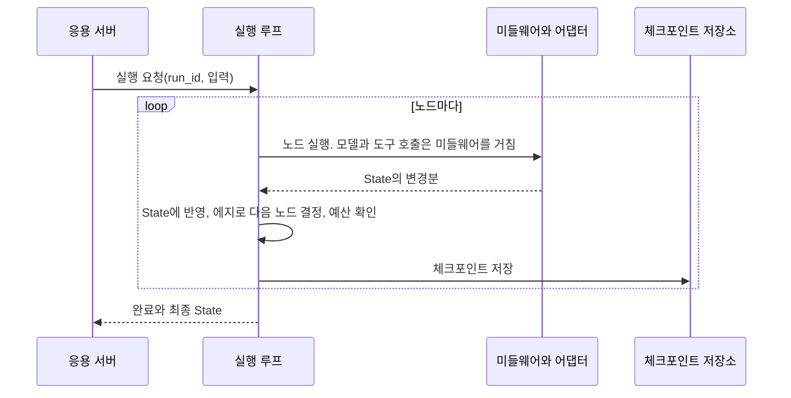
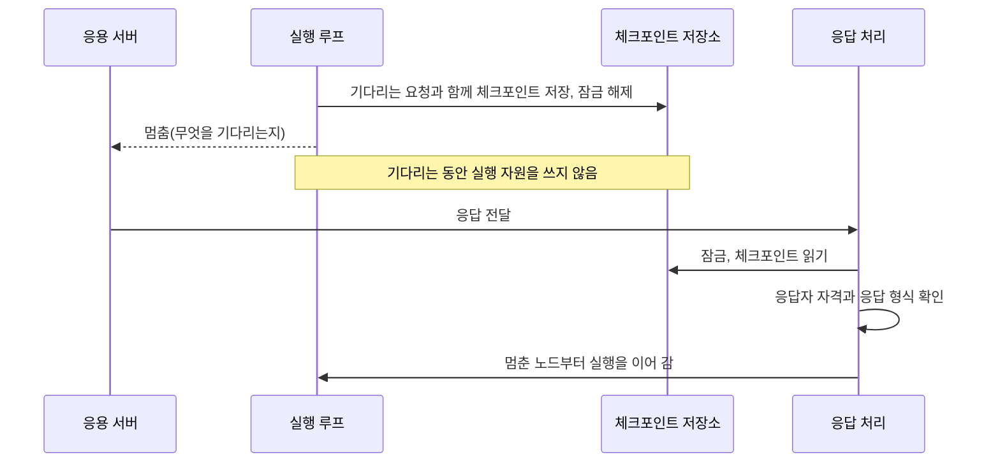
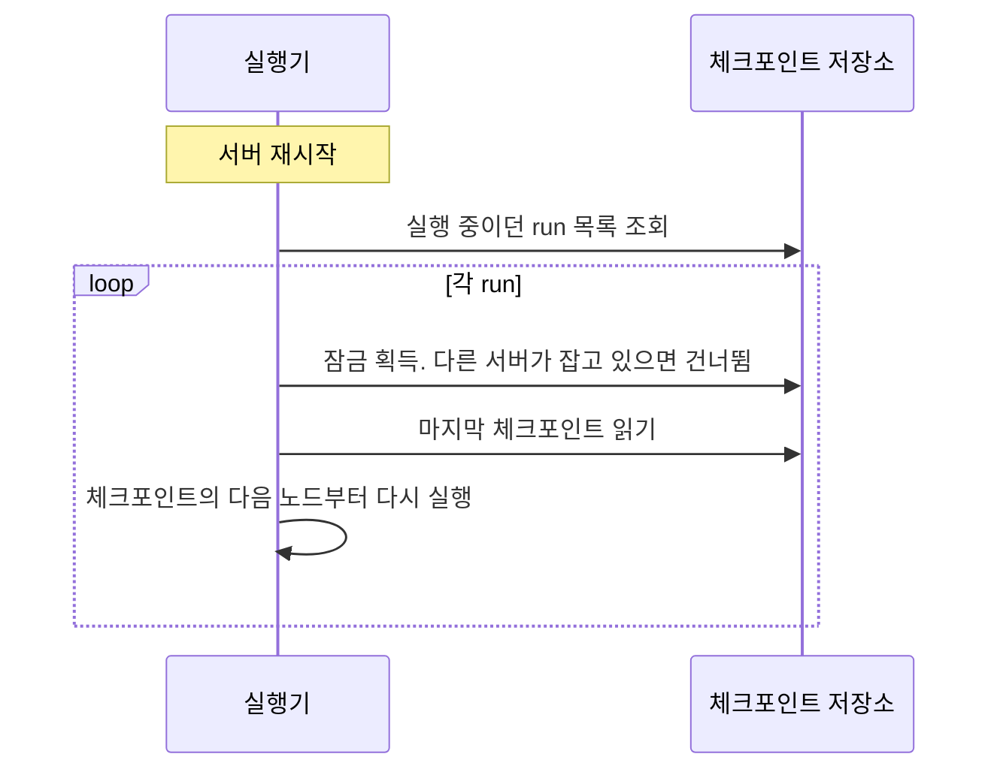

# AI Agent Workflow 프레임워크 설계서

> 이 문서는 AI Agent의 동작을 workflow로 정의하고 실행하는 프레임워크를 **만드는 쪽의 설계**를 다룹니다. 어떤 요구사항이 있는지, 그 요구사항을 만족하려면 어떤 구성 요소가 필요한지, 각 구성 요소가 어떻게 동작해야 하는지, 무엇을 고려해야 하는지를 차례로 설명합니다. 설계의 중심은 workflow를 정의하는 모델(3장)과 workflow를 실행하는 엔진(4장)입니다. 의사코드는 동작을 이해하기 위한 참고용이며, 특정 언어나 구현을 정하지 않습니다.

---

## 0. 개요

### 0.1 목적

AI Agent는 LLM이 관찰하고, 추론하고, 도구를 써서 행동하는 과정을 반복하며 목표를 달성하는 소프트웨어입니다. 이 과정을 LLM에게 자유롭게 맡기면 결과를 재현할 수 없고, 중단되면 이어 갈 수 없으며, 돈을 쓰거나 데이터를 바꾸는 행동을 통제할 수 없습니다.

이 프레임워크의 목적은 Agent의 동작을 **workflow로 명시적으로 정의**하고, 그 workflow를 **안전하고 이어 갈 수 있게 실행**하는 공통 기반을 제공하는 것입니다. LLM의 판단은 workflow의 정해진 자리에서만 쓰고, 실행의 흐름과 통제는 프레임워크가 책임집니다. 여러 팀이 각자 Agent를 만들더라도, 상태 저장, 재개, 승인, 추적 같은 공통 기능과 통제 규칙은 프레임워크가 한곳에서 보장합니다.

### 0.2 범위

| 범위 안 | 범위 밖 |
|---|---|
| workflow를 정의하는 모델과, 정의를 실행 전에 검사하는 규칙 | LLM 모델 자체의 학습이나 미세조정 |
| workflow를 실행하고, 중단되면 이어 가는 실행 엔진 | 개별 업무의 규칙과 도구의 업무 로직 |
| 사람이나 외부 시스템의 응답을 기다렸다가 이어 가는 기능 | 사용자 화면과 승인 화면 같은 UI |
| LLM 호출과 도구 호출에 끼워 넣는 통제 장치 | 업무 시스템과 조직의 인증 체계 자체 |
| 상태와 정의를 저장하는 저장소의 인터페이스 | 특정 DB 제품의 선택 |
| 추적, 비용 계측, 테스트 지원 | 운영 대시보드의 화면 설계 |

### 0.3 역할

| 역할 | 하는 일 |
|---|---|
| 플랫폼팀 | 프레임워크를 만들고 운영한다. 모든 Agent에 공통으로 적용되는 통제 규칙(필수 미들웨어, 도구 승인 규칙, 비용 한도)을 정한다 |
| Agent 개발자 | 프레임워크로 업무별 Agent를 만든다. workflow를 정의하고, 도구를 등록하고, 응용 서버에서 Agent를 실행한다 |

이 밖에 workflow 실행 중에 응답을 보내는 쪽(최종 사용자, 승인자, 외부 시스템)이 있지만, 이들은 프레임워크를 직접 다루지 않고 응용 서버를 통해 응답만 전달합니다.

### 0.4 설계 원칙

이후의 모든 설계 결정은 다음 세 원칙에서 나옵니다.

1. **workflow 정의와 실행 엔진을 분리한다.** workflow 정의는 실행 전에 검사되고 버전으로 고정되는 데이터입니다. 실행 엔진은 정의를 바꾸지 않고 그대로 실행합니다.
2. **실행은 언제든 이어 갈 수 있어야 한다.** 실행 상태는 단계마다 저장소에 저장합니다. 어느 지점에서 중단되더라도 마지막으로 저장한 지점부터 다시 시작할 수 있어야 합니다.
3. **LLM은 믿지 않는다.** LLM의 출력은 항상 형식과 내용을 검증하고, 되돌릴 수 없는 행동은 LLM이 직접 실행할 수 없는 자리에 둡니다.

### 0.5 용어

| 용어 | 뜻 |
|---|---|
| workflow | Agent의 동작을 노드와 에지로 정의한 것. 방향 그래프로 표현한다 |
| 노드(node) | workflow를 이루는 처리 단계 하나. 실제 동작은 노드 함수가 정한다 |
| 노드 함수 | 노드의 동작을 구현한 함수. State를 읽고, 필요하면 모델이나 도구를 부르거나 응답을 기다린 뒤, State에서 바뀐 부분을 돌려준다 |
| 에지(edge) | 노드와 노드를 잇는 연결. 한 노드가 끝난 뒤 어느 노드로 갈지 정한다 |
| State | workflow 하나가 실행되는 동안 노드들이 공유하는 데이터 |
| workflow 명세 | workflow 정의에서 어떤 노드가 있고, 노드가 어떻게 연결되어 있으며, 각 노드가 어떤 도구를 쓰고 무엇을 기다리는지만 뽑아 적은 문서. 코드를 실행하지 않고도 구조를 검사하고, 그림으로 그리고, 두 버전을 비교할 수 있게 해 준다(3.9절) |
| run | workflow 하나를 특정 입력으로 실행한 한 건 |
| step | run 안에서 노드 하나를 실행한 한 번. 같은 노드가 반복되면 step은 여러 개다 |
| call | step 안의 모델 호출이나 도구 호출 한 번 |
| 체크포인트 | step이 끝난 시점의 run 상태를 저장한 기록 |
| 요청(request) | 실행이 멈추면서 바깥에 보낸, 무엇을 언제까지 응답해야 하는지에 대한 요청 |
| turn | 응용 서버가 실행을 한 번 요청해서 결과를 받기까지의 구간. 사용자의 입력 하나에 해당한다 |
| 세션 | 한 사용자와 이어지는 대화. run 여러 개가 세션 하나에 속한다 |

### 0.6 이 문서의 구성

1장은 요구사항, 2장은 전체 구조입니다. 3장과 4장이 설계의 중심으로, 각각 workflow를 정의하는 모델과 workflow를 실행하는 엔진을 다룹니다. 5장과 6장은 실행을 받치는 구성 요소(LLM과 도구 연동, 저장소)이고, 7장은 구성 요소를 가로지르는 고려 사항입니다. 8장부터 10장까지는 설계 결정과 trade-off, 기존 접근 방식과의 비교, 요구사항 추적표를 정리합니다.

구성 요소를 설명하는 절은 모두 같은 틀을 따릅니다. 책임, 관련 요구사항, 동작 방식, 설계 결정과 대안, 고려 사항의 순서입니다.

---

## 1. 요구사항

### 1.1 문제 정의

LLM에게 Agent의 동작을 자유롭게 맡기면 다음 문제가 생깁니다.

| 문제 | 설명 |
|---|---|
| 재현할 수 없다 | 같은 입력에도 LLM이 매번 다른 경로를 고르므로, 결과를 재현하거나 테스트할 수 없다 |
| 이어 갈 수 없다 | 진행 상황이 프로세스의 메모리에만 있으므로, 서버가 멈추거나 재배포되면 처리 중인 요청이 사라진다 |
| 기다릴 수 없다 | 사람의 승인이나 외부 시스템의 처리 결과를 며칠씩 기다려야 하는 업무를 표현할 방법이 없다 |
| 통제할 수 없다 | LLM이 돈을 쓰거나 데이터를 바꾸는 도구를 직접 부르면, 그 사이에 정책 검사나 승인이 끼어들 자리가 없다 |
| 설명할 수 없다 | 왜 그런 결과가 나왔는지, 어떤 도구를 왜 불렀는지 추적할 수 없다 |
| 비용을 예측할 수 없다 | 반복 횟수와 입력 길이에 따라 LLM 호출 비용이 크게 달라진다 |

workflow 프레임워크는 이 문제를 다음과 같이 풉니다. Agent가 할 수 있는 일의 순서와 분기를 workflow로 미리 정의하고, LLM은 workflow 안의 정해진 노드에서 정해진 형식으로만 판단합니다. 실행 엔진은 workflow를 단계마다 저장하면서 실행하므로 중단되어도 이어 갈 수 있고, 모든 모델 호출과 도구 호출은 프레임워크의 통제 장치를 거칩니다.

### 1.2 기능 요구사항

| ID | 요구사항 | 설명 |
|---|---|---|
| FR-01 | workflow 정의 | 노드, 에지, State 형식으로 workflow를 정의할 수 있다. 에지는 고정, 조건부 분기, 병렬, 반복을 표현할 수 있어야 한다 |
| FR-02 | 정의 검증 | 실행하기 전에 구조 오류(도달할 수 없는 노드, 없는 노드로 가는 분기, 상한 없는 반복)와 통제 규칙 위반(승인 없는 되돌릴 수 없는 도구)을 찾아낸다 |
| FR-03 | 실행 | 정의된 workflow를 노드 단위로 실행하고, 노드 사이에 State를 전달한다 |
| FR-04 | 상태 저장과 재개 | 실행 상태를 저장하고, 중단된 run을 마지막으로 저장한 지점부터 이어 간다 |
| FR-05 | 대기와 재개 | 사람, 외부 시스템, 정해진 시각을 기다렸다가 응답이 오면 이어 간다. 응답이 오지 않으면 정해진 기한에 다른 경로로 보낸다 |
| FR-06 | 모델 호출 | 모델 제공자에 독립적인 방식으로 LLM을 부르고, 출력 형식을 강제하고 검증한다 |
| FR-07 | 도구 등록과 통제 | 도구를 메타데이터(되돌릴 수 있는지, 필요한 권한)와 함께 등록하고, 메타데이터에 따라 호출을 통제한다 |
| FR-08 | 병렬 실행 | 서로 독립적인 노드를 동시에 실행하고 결과를 합친다 |
| FR-09 | workflow 조합 | 다른 workflow를 노드로 넣어 쓸 수 있다. 여러 Agent의 협업은 이 조합으로 표현한다 |
| FR-10 | 공통 처리 확장 | 추적, 권한 검사, 마스킹 같은 공통 처리를 노드 실행과 호출의 전후에 끼워 넣을 수 있다 |
| FR-11 | 추적과 비용 계측 | 모든 노드 실행, 모델 호출, 도구 호출의 시간, 토큰, 비용, 결과를 기록한다 |
| FR-12 | 버전 관리 | workflow 정의를 버전으로 관리하고, 진행 중인 run은 시작할 때의 버전으로 끝까지 실행한다 |
| FR-13 | 세션 | 한 사용자와의 대화에서 시작된 여러 run을 이어서 관리한다 |
| FR-14 | 테스트 지원 | LLM과 외부 시스템 없이 workflow의 흐름을 테스트할 수 있다 |
| FR-15 | 운영 제어 | 진행 중인 run을 조회하고, 취소하고, 특정 단계부터 다시 실행할 수 있다 |

### 1.3 비기능 요구사항

비기능 요구사항은 측정할 수 있는 기준과 함께 정의합니다. 수치는 예시이며, 도입하는 조직의 상황에 맞게 정합니다.

| ID | 범주 | 요구사항 | 측정 기준(예시) |
|---|---|---|---|
| NFR-01 | 신뢰성 | 서버 장애나 재배포가 있어도 진행 중인 run이 유실되지 않는다 | 장애 주입 시험에서 run 유실 0건 |
| NFR-02 | 정확히 한 번의 외부 변경 | 같은 단계가 다시 실행되어도 외부 시스템의 변경은 한 번만 일어난다 | 중복 실행 시험에서 외부 변경 1회 |
| NFR-03 | 통제 | 되돌릴 수 없는 작업은 사람의 확인 없이 실행되지 않는다. 이 통제는 Agent 개발자가 끌 수 없다 | 확인 없이 실행된 되돌릴 수 없는 호출 0건 |
| NFR-04 | 장기 대기 | 응답을 기다리는 run은 며칠 동안 보존되고, 기다리는 동안 실행 자원을 쓰지 않는다 | 대기 중인 run이 점유하는 스레드 0개 |
| NFR-05 | 보안 | 사용자 입력과 도구 결과에 악의적인 지시문이 있다고 가정한다. 도구는 최소 권한으로 실행하고, 개인정보는 기록에서 가린다 | 기록에 남은 개인정보 원문 0건 |
| NFR-06 | 비용 통제 | run과 turn 단위로 비용 상한을 두고, 상한을 넘는 호출은 보내기 전에 막는다 | 상한을 넘은 run 0건 |
| NFR-07 | 지연 | 프레임워크가 더하는 시간이 전체 응답 시간을 지배하지 않는다 | 노드 하나당 프레임워크 오버헤드 p95 50ms 이하 |
| NFR-08 | 확장성 | 응용 서버를 늘리면 동시에 처리하는 run의 수가 늘어난다 | 서버 수에 비례한 처리량 증가 |
| NFR-09 | 관측 가능성 | 모든 모델 호출과 도구 호출이 추적된다 | 추적 누락 0건 |
| NFR-10 | 테스트 용이성 | LLM과 외부 시스템 없이 workflow의 모든 경로를 결정적으로 테스트할 수 있다 | 흐름 테스트에서 LLM 호출 0회 |
| NFR-11 | 이식성 | 저장소 구현과 모델 제공자를 프레임워크 코드 수정 없이 바꿀 수 있다 | 저장소 교체 시 실행 엔진 코드 변경 0줄 |

### 1.4 제약과 가정

- workflow를 작성하는 사람은 모두 개발자입니다. 업무 담당자는 workflow를 직접 고치지 않고 검토만 합니다.
- LLM의 출력은 비결정적이고 틀릴 수 있습니다. 같은 입력에도 다른 출력이 나올 수 있습니다.
- 사용자 입력, 첨부 문서, 도구 결과에는 악의적인 지시문이 섞여 있을 수 있습니다.
- 외부 시스템 가운데 일부만 멱등성 키(같은 요청을 한 번만 처리하게 하는 식별자)를 지원합니다.
- 기다림은 몇 초(사용자의 확인)부터 며칠(담당자의 승인)까지 다양합니다.
- 여러 팀이 같은 프레임워크로 각자의 Agent를 만들며, 공통 통제 규칙은 플랫폼팀이 강제합니다.

### 1.5 요구사항이 설계에 던지는 질문

요구사항을 만족하려면 설계가 다음 질문에 답해야 합니다. 이 질문들이 이후 장의 뼈대가 됩니다.

| 질문 | 관련 요구사항 | 답하는 곳 |
|---|---|---|
| workflow를 어떤 의미론(그래프의 종류)으로 정의하고, 무엇으로 표현할 것인가 | FR-01 | 3.1절, 3.2절 |
| 반복을 허용하면서 무한 반복은 어떻게 막을 것인가 | FR-01, FR-02, NFR-06 | 3.5절 |
| 실행 전에 무엇을 어떻게 검사할 것인가 | FR-02, NFR-03 | 3.8절 |
| 실행 상태를 무엇으로, 언제 저장할 것인가 | FR-04, NFR-01 | 4.2절 |
| 기다리는 동안 자원을 쓰지 않으려면 실행을 어떻게 멈추고 이어 갈 것인가 | FR-05, NFR-04 | 4.3절 |
| 다시 실행해도 외부 변경이 한 번만 일어나게 하려면 어떻게 할 것인가 | NFR-02 | 4.6절 |
| LLM이 되돌릴 수 없는 도구를 부르지 못하게 하려면 어떻게 할 것인가 | FR-07, NFR-03, NFR-05 | 5.2절, 5.3절 |
| 공통 통제를 모든 Agent에 빠짐없이 적용하려면 어떻게 할 것인가 | FR-10, NFR-03, NFR-09 | 5.4절 |
| 실행 엔진을 별도 서버로 둘 것인가, 라이브러리로 둘 것인가 | NFR-07, NFR-08 | 2.4절 |

---

## 2. 아키텍처 개요

### 2.1 전체 구조

프레임워크는 크게 둘로 이루어집니다. workflow를 실행하는 **실행기**(라이브러리)와, 실행기가 읽고 쓰는 **저장소 인터페이스**입니다.

그림은 위에서 아래로 네 계층입니다.

1. **호출하는 쪽**: Agent 개발자의 코드가 workflow와 도구를 등록하고 Agent를 실행합니다. 사용자, 승인자, 외부 시스템은 실행이 기다리던 응답을 보냅니다.
2. **실행기**: 실행 요청과 응답을 받아 workflow를 실행합니다. 실행 루프가 중심이고, 응답 처리, 타임아웃 처리, 미들웨어 체인, 추적과 비용 집계가 함께 동작합니다.
3. **인터페이스와 어댑터**: 실행기는 저장소와 바깥 시스템에 직접 닿지 않습니다. 저장소는 인터페이스로, 모델과 도구는 어댑터로 거칩니다.
4. **구현과 외부 시스템**: 저장소 인터페이스를 실제로 구현한 저장소와, 어댑터가 부르는 모델 제공자와 업무 시스템입니다.

모델 어댑터와 도구 어댑터는 실행기 라이브러리에 포함되지만, 바깥 시스템과 맞닿는 부분이므로 그림에서는 아래 계층에 따로 그렸습니다. 화살표는 실행 중에 호출이 흐르는 방향입니다.

### 2.2 구성 요소와 책임

| 묶음 | 구성 요소 | 책임 | 관련 요구사항 | 설명하는 곳 |
|---|---|---|---|---|
| 정의 | workflow 빌더 | 노드와 에지를 모아 workflow 명세를 만들고, 실행 전에 검사한다 | FR-01, FR-02 | 3장 |
| 실행기 | 실행 루프 | 노드를 실행하고, 변경분을 State에 반영하고, 에지로 다음 노드를 정하고, 예산을 확인하고, 단계마다 체크포인트를 저장한다 | FR-03, FR-04 | 4.1절 |
| | 응답 처리 | 사람이나 외부 시스템이 보낸 응답을 받아 응답자의 자격과 응답 형식을 확인하고, 멈춘 run을 이어 간다 | FR-05 | 4.3절 |
| | 타임아웃 처리 | 기한이 지난 대기를 주기적으로 찾아 만료로 처리하고 run을 이어 간다. 프레임워크에서 스스로 동작하는 유일한 배경 작업이다 | FR-05 | 4.3절 |
| | 미들웨어 체인 | 노드 실행, 모델 호출, 도구 호출의 전후에 공통 처리를 끼워 넣는다. 플랫폼 필수 미들웨어는 끌 수 없다 | FR-10, NFR-03 | 5.4절 |
| | 모델 어댑터 | 모델 별칭을 실제 모델로 바꾸고, 출력 형식을 강제하고, 재시도와 대체 모델 호출을 처리한다 | FR-06 | 5.1절 |
| | 도구 어댑터 | 도구 메타데이터에 따라 시간 제한, 재시도, 호출량 제한을 적용하고 외부 시스템을 부른다 | FR-07 | 5.2절 |
| | 추적과 비용 집계 | 모든 호출의 소요 시간, 토큰, 비용을 기록하고 run 단위로 합산한다 | FR-11, NFR-09 | 7.4절 |
| 저장소 | workflow 레지스트리 | workflow 명세를 이름과 버전으로 저장하고, 새 run이 쓸 버전을 정한다 | FR-12 | 6.1절 |
| | 도구 레지스트리 | 도구와 메타데이터를 저장한다 | FR-07 | 6.1절 |
| | 체크포인트 저장소 | 단계마다 run의 상태를 저장하고, 한 run을 한 서버만 실행하도록 잠금을 제공한다 | FR-04, NFR-01 | 4.2절, 6.1절 |
| | 세션 저장소 | 한 사용자와의 대화 기록과, 그 대화에서 시작한 run의 목록과 결과를 저장한다 | FR-13 | 4.3절, 6.1절 |

모든 저장소는 인터페이스로만 정의합니다. 관계형 DB, 문서 DB, 키-값 저장소, 파일, 메모리 가운데 무엇으로든 구현할 수 있습니다(NFR-11).

### 2.3 주요 흐름

#### 2.3.1 실행

응용 서버가 실행을 요청하면, 실행 루프는 시작 노드부터 노드를 하나씩 실행합니다. 노드 함수가 모델이나 도구를 부를 때는 반드시 미들웨어 체인과 어댑터를 거칩니다. 노드가 끝날 때마다 바뀐 State와 다음 노드를 체크포인트로 저장하고, 나가는 에지가 없는 노드에 이르면 run을 끝냅니다.

#### 2.3.2 멈춤과 재개

노드가 응답을 기다려야 하면 실행을 멈춥니다. 실행 루프는 기다리는 요청을 담은 체크포인트를 저장하고 run의 잠금을 놓은 뒤, 응용 서버에 무엇을 기다리는지 돌려줍니다. 이때부터 run은 저장소에 체크포인트로만 존재하고, 어떤 스레드도 run을 붙잡고 있지 않습니다. 응답이 오면 응답 처리가 자격과 형식을 확인하고, 멈춘 노드부터 실행을 이어 갑니다. 응답이 기한 안에 오지 않으면 타임아웃 처리가 만료 응답으로 run을 이어 갑니다.

#### 2.3.3 장애 후 복구

서버가 다시 시작되면 실행기는 저장소에서 실행 중이던 run을 찾아, 마지막 체크포인트에 적힌 다음 노드부터 다시 실행합니다. 기다리던 run은 찾지 않고 그대로 둡니다. 응답이 오거나 기한이 지나면 그때 이어 가면 됩니다. 다시 실행한 노드 안의 도구 호출에는 처음과 같은 멱등성 키가 붙으므로, 외부 시스템의 변경은 한 번만 일어납니다(4.6절).

### 2.4 배치 형태

실행 엔진을 어떤 형태로 배치할지에 따라 구성 요소의 수와 운영 방식이 크게 달라집니다.

| 대안 | 구조 | 장점 | 단점 |
|---|---|---|---|
| 서버형 오케스트레이터 | 스케줄러가 실행할 단계를 정해 작업 큐에 넣고, 작업자 프로세스가 꺼내 실행한다 | 실행 부하를 응용 서버와 분리한다. 대량의 단계를 고르게 나눈다 | 구성 요소가 많아 운영과 장애 분석이 어렵다. 모든 단계가 큐와 네트워크를 한 번 더 거친다 |
| 라이브러리형 실행기와 공유 저장소 | 응용 서버의 프로세스 안에서 실행기가 workflow를 실행한다. 여러 서버가 같은 저장소를 공유한다 | 별도 서버가 없고 장애 지점이 적다. 테스트에서 같은 코드를 메모리 저장소로 실행할 수 있다 | 실행 부하가 응용 서버에 얹힌다 |

**결정: 라이브러리형 실행기와 공유 저장소로 배치합니다.**

Agent의 run은 대부분 몇 초 동안 노드 몇 개를 실행하고, 사람을 기다리는 동안에는 아무 자원도 쓰지 않는 모양입니다(NFR-04). 기다리는 run은 저장소에 체크포인트로만 있으므로, 실행을 위한 작업자 풀을 따로 둘 이유가 적습니다. 여러 서버가 같은 저장소를 바라보므로 어느 서버에서 멈춘 run이든 다른 서버가 이어 갈 수 있고, 한 run을 두 서버가 동시에 실행하지 않도록 저장소의 잠금(lease)을 씁니다. 처리량은 응용 서버를 늘려서 확보합니다(NFR-08).

이 결정의 한계는 긴 배치 작업처럼 실행 시간이 긴 run이 응용 서버의 응답을 느리게 할 수 있다는 점입니다. 그런 run이 많아지면 같은 실행기 라이브러리를 쓰는 별도 작업 서버를 두어 분리할 수 있으며, 저장소 인터페이스가 같으므로 실행 엔진의 설계는 바뀌지 않습니다.

### 2.5 구성 요소 사이의 경계

구성 요소 사이에는 다음 경계를 지킵니다. 이 경계가 설계 원칙을 구조로 보장합니다.

| 경계 | 내용 | 지키는 원칙과 요구사항 |
|---|---|---|
| 정의와 실행 | 실행 엔진은 workflow 명세를 읽기만 하고 바꾸지 않는다. run은 시작할 때의 버전에 고정된다 | 원칙 1, FR-12 |
| 실행기와 저장소 | 실행기는 저장소를 인터페이스로만 다룬다. 실행 상태는 메모리가 아니라 저장소에 있다 | 원칙 2, NFR-01, NFR-11 |
| 노드와 외부 세계 | 노드 함수는 모델과 도구를 프레임워크가 제공하는 호출 경로로만 부른다. 그래서 모든 호출이 미들웨어 체인을 거친다 | 원칙 3, NFR-03, NFR-09 |
| 플랫폼과 Agent 개발자 | 플랫폼 필수 미들웨어와 정의 검사 규칙은 Agent 개발자가 끌 수 없다 | NFR-03 |

---

*(3장 "workflow 정의 모델"부터 작성할 예정입니다.)*
