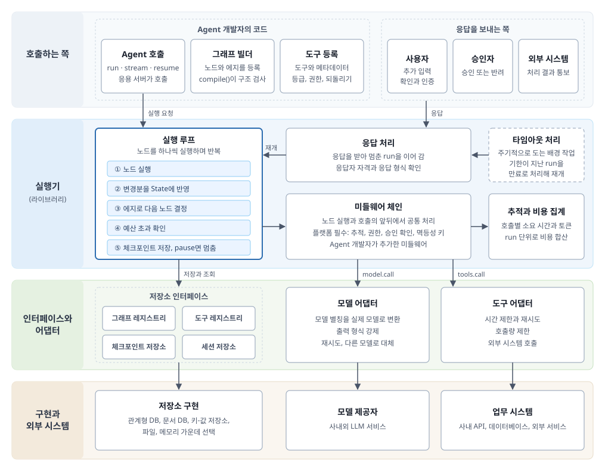
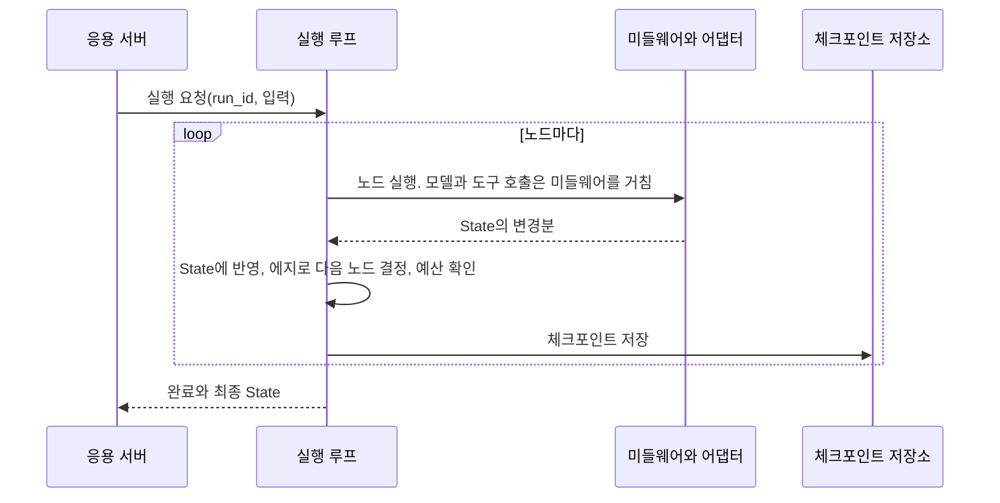
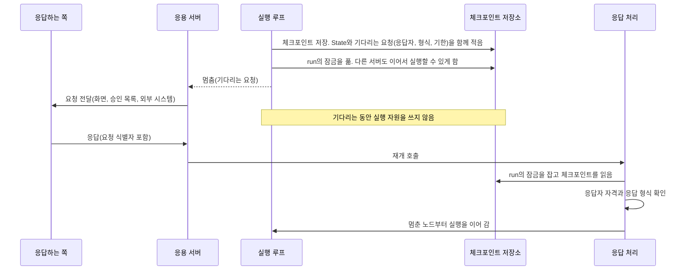
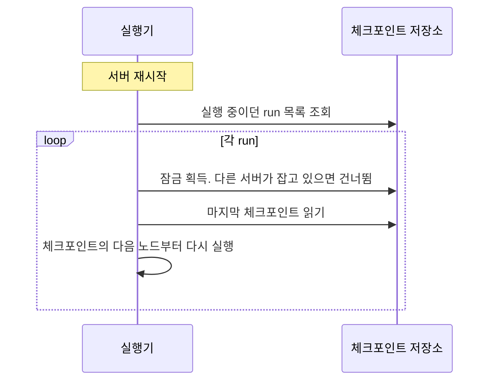

# AI Agent Workflow 프레임워크 설계서

> 이 문서는 AI Agent의 동작을 workflow로 정의하고 실행하는 프레임워크를 **만드는 쪽의 설계**를 다룹니다. 어떤 요구사항이 있는지, 그 요구사항을 만족하려면 어떤 구성 요소가 필요한지, 각 구성 요소가 어떻게 동작해야 하는지, 무엇을 고려해야 하는지를 차례로 설명합니다. 설계의 중심은 workflow를 정의하는 모델(3장)과 workflow를 실행하는 엔진(4장)입니다. 의사코드는 동작을 이해하기 위한 참고용이며, 특정 언어나 구현을 정하지 않습니다.

---

## 0. 개요

### 0.1 목적

AI Agent는 LLM이 관찰하고, 추론하고, 도구를 써서 행동하는 과정을 반복하며 목표를 달성하는 소프트웨어입니다. 이 과정을 LLM에게 자유롭게 맡기면 결과를 재현할 수 없고, 중단되면 이어 갈 수 없으며, 돈을 쓰거나 데이터를 바꾸는 행동을 통제할 수 없습니다.

이 프레임워크의 목적은 Agent의 동작을 **workflow로 명시적으로 정의**하고, 그 workflow를 **안전하고 이어 갈 수 있게 실행**하는 공통 기반을 제공하는 것입니다. LLM의 판단은 workflow의 정해진 자리에서만 쓰고, 실행의 흐름과 통제는 프레임워크가 책임집니다. 여러 팀이 각자 Agent를 만들더라도, 상태 저장, 재개, 승인, 추적 같은 공통 기능과 통제 규칙은 프레임워크가 한곳에서 보장합니다.

### 0.2 범위

| 범위 안 | 범위 밖 |
|---|---|
| workflow를 정의하는 모델과, 정의를 실행 전에 검사하는 규칙 | LLM 모델 자체의 학습이나 미세조정 |
| workflow를 실행하고, 중단되면 이어 가는 실행 엔진 | 개별 업무의 규칙과 도구의 업무 로직 |
| 사람이나 외부 시스템의 응답을 기다렸다가 이어 가는 기능 | 사용자 화면과 승인 화면 같은 UI |
| LLM 호출과 도구 호출에 끼워 넣는 통제 장치 | 업무 시스템과 조직의 인증 체계 자체 |
| 상태와 정의를 저장하는 저장소의 인터페이스 | 특정 DB 제품의 선택 |
| 추적, 비용 계측, 테스트 지원 | 운영 대시보드의 화면 설계 |

### 0.3 역할

| 역할 | 하는 일 |
|---|---|
| 플랫폼팀 | 프레임워크를 만들고 운영한다. 모든 Agent에 공통으로 적용되는 통제 규칙(필수 미들웨어, 도구 승인 규칙, 비용 한도)을 정한다 |
| Agent 개발자 | 프레임워크로 업무별 Agent를 만든다. workflow를 정의하고, 도구를 등록하고, 응용 서버에서 Agent를 실행한다 |

이 밖에 workflow 실행 중에 응답을 보내는 쪽(최종 사용자, 승인자, 외부 시스템)이 있지만, 이들은 프레임워크를 직접 다루지 않고 응용 서버를 통해 응답만 전달합니다.

### 0.4 설계 원칙

이후의 모든 설계 결정은 다음 세 원칙에서 나옵니다.

1. **workflow 정의와 실행 엔진을 분리한다.** workflow 정의는 실행 전에 검사되고 버전으로 고정되는 데이터입니다. 실행 엔진은 정의를 바꾸지 않고 그대로 실행합니다.
2. **실행은 언제든 이어 갈 수 있어야 한다.** 실행 상태는 단계마다 저장소에 저장합니다. 어느 지점에서 중단되더라도 마지막으로 저장한 지점부터 다시 시작할 수 있어야 합니다.
3. **LLM은 믿지 않는다.** LLM의 출력은 항상 형식과 내용을 검증하고, 되돌릴 수 없는 행동은 LLM이 직접 실행할 수 없는 자리에 둡니다.

### 0.5 용어

| 용어 | 뜻 |
|---|---|
| workflow | Agent의 동작을 노드와 에지로 정의한 것. 방향 그래프로 표현한다 |
| 노드(node) | workflow를 이루는 처리 단계 하나. 실제 동작은 노드 함수가 정한다 |
| 노드 함수 | 노드의 동작을 구현한 함수. State를 읽고, 필요하면 모델이나 도구를 부르거나 응답을 기다린 뒤, State에서 바뀐 부분을 돌려준다 |
| 에지(edge) | 노드와 노드를 잇는 연결. 한 노드가 끝난 뒤 어느 노드로 갈지 정한다 |
| State | workflow 하나가 실행되는 동안 노드들이 공유하는 데이터 |
| workflow 명세 | workflow 정의에서 어떤 노드가 있고, 노드가 어떻게 연결되어 있으며, 각 노드가 어떤 도구를 쓰고 무엇을 기다리는지만 뽑아 적은 문서. 코드를 실행하지 않고도 구조를 검사하고, 그림으로 그리고, 두 버전을 비교할 수 있게 해 준다(3.9절) |
| run | workflow 하나를 특정 입력으로 실행한 한 건 |
| step | run 안에서 노드 하나를 실행한 한 번. 같은 노드가 반복되면 step은 여러 개다 |
| call | step 안의 모델 호출이나 도구 호출 한 번 |
| 도구 | 노드가 외부 시스템을 조회하거나 바꾸려고 부르는 기능. 메타데이터와 함께 도구 레지스트리에 등록한다 |
| 도구의 등급 | 도구가 바깥에 미치는 영향. `none`(바깥을 바꾸지 않음. 예: 주문 조회), `reversible`(바꾸지만 짝이 되는 취소 도구로 되돌릴 수 있음. 예: 수거 예약), `irreversible`(바꾸고 되돌릴 방법이 없음. 예: 송금, 환불 실행, 문자 발송) 가운데 하나다. 되돌릴 수 없는 도구에는 가장 강한 통제를 건다(5.2절) |
| 체크포인트 | run이 어디까지 진행했는지 저장소에 적어 둔 기록. 노드가 끝날 때와 멈출 때 저장한다(2.3.1절) |
| 요청(request) | 실행이 멈추면서 바깥에 보낸, 무엇을 언제까지 응답해야 하는지에 대한 요청 |
| turn | 응용 서버가 실행을 한 번 요청해서 결과를 받기까지의 구간. 사용자의 입력 하나에 해당한다 |
| 세션 | 한 사용자와 이어지는 대화. run 여러 개가 세션 하나에 속한다 |

### 0.6 이 문서의 구성

1장은 요구사항, 2장은 전체 구조입니다. 3장과 4장이 설계의 중심으로, 각각 workflow를 정의하는 모델과 workflow를 실행하는 엔진을 다룹니다. 5장과 6장은 실행을 받치는 구성 요소(LLM과 도구 연동, 저장소)이고, 7장은 구성 요소를 가로지르는 고려 사항입니다. 8장부터 10장까지는 설계 결정과 trade-off, 기존 접근 방식과의 비교, 요구사항 추적표를 정리합니다.

구성 요소를 설명하는 절은 모두 같은 틀을 따릅니다. 책임, 관련 요구사항, 동작 방식, 설계 결정과 대안, 고려 사항의 순서입니다.

---

## 1. 요구사항

### 1.1 문제 정의

LLM에게 Agent의 동작을 자유롭게 맡기면 다음 문제가 생깁니다.

| 문제 | 설명 |
|---|---|
| 재현할 수 없다 | 같은 입력에도 LLM이 매번 다른 경로를 고르므로, 결과를 재현하거나 테스트할 수 없다 |
| 이어 갈 수 없다 | 진행 상황이 프로세스의 메모리에만 있으므로, 서버가 멈추거나 재배포되면 처리 중인 요청이 사라진다 |
| 기다릴 수 없다 | 사람의 승인이나 외부 시스템의 처리 결과를 며칠씩 기다려야 하는 업무를 표현할 방법이 없다 |
| 통제할 수 없다 | LLM이 돈을 쓰거나 데이터를 바꾸는 도구를 직접 부르면, 그 사이에 정책 검사나 승인이 끼어들 자리가 없다 |
| 설명할 수 없다 | 왜 그런 결과가 나왔는지, 어떤 도구를 왜 불렀는지 추적할 수 없다 |
| 비용을 예측할 수 없다 | 반복 횟수와 입력 길이에 따라 LLM 호출 비용이 크게 달라진다 |

workflow 프레임워크는 이 문제를 다음과 같이 풉니다. Agent가 할 수 있는 일의 순서와 분기를 workflow로 미리 정의하고, LLM은 workflow 안의 정해진 노드에서 정해진 형식으로만 판단합니다. 실행 엔진은 workflow를 단계마다 저장하면서 실행하므로 중단되어도 이어 갈 수 있고, 모든 모델 호출과 도구 호출은 프레임워크의 통제 장치를 거칩니다.

### 1.2 기능 요구사항

| ID | 요구사항 | 설명 |
|---|---|---|
| FR-01 | workflow 정의 | 노드, 에지, State 형식으로 workflow를 정의할 수 있다. 에지는 고정, 조건부 분기, 병렬, 반복을 표현할 수 있어야 한다 |
| FR-02 | 정의 검증 | 실행하기 전에 구조 오류(도달할 수 없는 노드, 없는 노드로 가는 분기, 상한 없는 반복)와 통제 규칙 위반(승인 없는 되돌릴 수 없는 도구)을 찾아낸다 |
| FR-03 | 실행 | 정의된 workflow를 노드 단위로 실행하고, 노드 사이에 State를 전달한다 |
| FR-04 | 상태 저장과 재개 | 실행 상태를 저장하고, 중단된 run을 마지막으로 저장한 지점부터 이어 간다 |
| FR-05 | 대기와 재개 | 사람, 외부 시스템, 정해진 시각을 기다렸다가 응답이 오면 이어 간다. 응답이 오지 않으면 정해진 기한에 다른 경로로 보낸다 |
| FR-06 | 모델 호출 | 모델 제공자에 독립적인 방식으로 LLM을 부르고, 출력 형식을 강제하고 검증한다 |
| FR-07 | 도구 등록과 통제 | 도구를 메타데이터(되돌릴 수 있는지, 필요한 권한)와 함께 등록하고, 메타데이터에 따라 호출을 통제한다 |
| FR-08 | 병렬 실행 | 서로 독립적인 노드를 동시에 실행하고 결과를 합친다 |
| FR-09 | workflow 조합 | 다른 workflow를 노드로 넣어 쓸 수 있다. 여러 Agent의 협업은 이 조합으로 표현한다 |
| FR-10 | 공통 처리 확장 | 추적, 권한 검사, 마스킹 같은 공통 처리를 노드 실행과 호출의 전후에 끼워 넣을 수 있다 |
| FR-11 | 추적과 비용 계측 | 모든 노드 실행, 모델 호출, 도구 호출의 시간, 토큰, 비용, 결과를 기록한다 |
| FR-12 | 버전 관리 | workflow 정의를 버전으로 관리하고, 진행 중인 run은 시작할 때의 버전으로 끝까지 실행한다 |
| FR-13 | 세션 | 한 사용자와의 대화에서 시작된 여러 run을 이어서 관리한다 |
| FR-14 | 테스트 지원 | LLM과 외부 시스템 없이 workflow의 흐름을 테스트할 수 있다 |
| FR-15 | 운영 제어 | 진행 중인 run을 조회하고, 취소하고, 특정 단계부터 다시 실행할 수 있다 |

### 1.3 비기능 요구사항

비기능 요구사항은 측정할 수 있는 기준과 함께 정의합니다. 수치는 예시이며, 도입하는 조직의 상황에 맞게 정합니다.

| ID | 범주 | 요구사항 | 측정 기준(예시) |
|---|---|---|---|
| NFR-01 | 신뢰성 | 서버 장애나 재배포가 있어도 진행 중인 run이 유실되지 않는다 | 장애 주입 시험에서 run 유실 0건 |
| NFR-02 | 정확히 한 번의 외부 변경 | 같은 단계가 다시 실행되어도 외부 시스템의 변경은 한 번만 일어난다 | 중복 실행 시험에서 외부 변경 1회 |
| NFR-03 | 통제 | 되돌릴 수 없는 작업은 사람의 확인 없이 실행되지 않는다. 이 통제는 Agent 개발자가 끌 수 없다 | 확인 없이 실행된 되돌릴 수 없는 호출 0건 |
| NFR-04 | 장기 대기 | 응답을 기다리는 run은 며칠 동안 보존되고, 기다리는 동안 실행 자원을 쓰지 않는다 | 대기 중인 run이 점유하는 스레드 0개 |
| NFR-05 | 보안 | 사용자 입력과 도구 결과에 악의적인 지시문이 있다고 가정한다. 도구는 최소 권한으로 실행하고, 개인정보는 기록에서 가린다 | 기록에 남은 개인정보 원문 0건 |
| NFR-06 | 비용 통제 | run과 turn 단위로 비용 상한을 두고, 상한을 넘는 호출은 보내기 전에 막는다 | 상한을 넘은 run 0건 |
| NFR-07 | 지연 | 프레임워크가 더하는 시간이 전체 응답 시간을 지배하지 않는다 | 노드 하나당 프레임워크 오버헤드 p95 50ms 이하 |
| NFR-08 | 확장성 | 응용 서버를 늘리면 동시에 처리하는 run의 수가 늘어난다 | 서버 수에 비례한 처리량 증가 |
| NFR-09 | 관측 가능성 | 모든 모델 호출과 도구 호출이 추적된다 | 추적 누락 0건 |
| NFR-10 | 테스트 용이성 | LLM과 외부 시스템 없이 workflow의 모든 경로를 결정적으로 테스트할 수 있다 | 흐름 테스트에서 LLM 호출 0회 |
| NFR-11 | 이식성 | 저장소 구현과 모델 제공자를 프레임워크 코드 수정 없이 바꿀 수 있다 | 저장소 교체 시 실행 엔진 코드 변경 0줄 |

### 1.4 제약과 가정

- workflow를 작성하는 사람은 모두 개발자입니다. 업무 담당자는 workflow를 직접 고치지 않고 검토만 합니다.
- LLM의 출력은 비결정적이고 틀릴 수 있습니다. 같은 입력에도 다른 출력이 나올 수 있습니다.
- 사용자 입력, 첨부 문서, 도구 결과에는 악의적인 지시문이 섞여 있을 수 있습니다.
- 외부 시스템 가운데 일부만 멱등성 키(같은 요청을 한 번만 처리하게 하는 식별자)를 지원합니다.
- 기다림은 몇 초(사용자의 확인)부터 며칠(담당자의 승인)까지 다양합니다.
- 여러 팀이 같은 프레임워크로 각자의 Agent를 만들며, 공통 통제 규칙은 플랫폼팀이 강제합니다.

### 1.5 요구사항이 설계에 던지는 질문

요구사항을 만족하려면 설계가 다음 질문에 답해야 합니다. 이 질문들이 이후 장의 뼈대가 됩니다.

| 질문 | 관련 요구사항 | 답하는 곳 |
|---|---|---|
| workflow를 어떤 의미론(그래프의 종류)으로 정의하고, 무엇으로 표현할 것인가 | FR-01 | 3.1절, 3.2절 |
| 반복을 허용하면서 무한 반복은 어떻게 막을 것인가 | FR-01, FR-02, NFR-06 | 3.5절 |
| 실행 전에 무엇을 어떻게 검사할 것인가 | FR-02, NFR-03 | 3.8절 |
| 실행 상태를 무엇으로, 언제 저장할 것인가 | FR-04, NFR-01 | 4.2절 |
| 기다리는 동안 자원을 쓰지 않으려면 실행을 어떻게 멈추고 이어 갈 것인가 | FR-05, NFR-04 | 4.3절 |
| 다시 실행해도 외부 변경이 한 번만 일어나게 하려면 어떻게 할 것인가 | NFR-02 | 4.6절 |
| LLM이 되돌릴 수 없는 도구를 부르지 못하게 하려면 어떻게 할 것인가 | FR-07, NFR-03, NFR-05 | 5.2절, 5.3절 |
| 공통 통제를 모든 Agent에 빠짐없이 적용하려면 어떻게 할 것인가 | FR-10, NFR-03, NFR-09 | 5.4절 |
| 실행 엔진을 별도 서버로 둘 것인가, 라이브러리로 둘 것인가 | NFR-07, NFR-08 | 2.4절 |

---

## 2. 아키텍처 개요

### 2.1 전체 구조

프레임워크는 크게 둘로 이루어집니다. workflow를 실행하는 **실행기**(라이브러리)와, 실행기가 읽고 쓰는 **저장소 인터페이스**입니다.



그림은 위에서 아래로 네 계층입니다.

1. **호출하는 쪽**: Agent 개발자의 코드가 workflow와 도구를 등록하고 Agent를 실행합니다. 사용자, 승인자, 외부 시스템은 실행이 기다리던 응답을 보냅니다.
2. **실행기**: 실행 요청과 응답을 받아 workflow를 실행합니다. 실행 루프가 중심이고, 응답 처리, 타임아웃 처리, 미들웨어 체인, 추적과 비용 집계가 함께 동작합니다.
3. **인터페이스와 어댑터**: 실행기는 저장소와 바깥 시스템에 직접 닿지 않습니다. 저장소는 인터페이스로, 모델과 도구는 어댑터로 거칩니다.
4. **구현과 외부 시스템**: 저장소 인터페이스를 실제로 구현한 저장소와, 어댑터가 부르는 모델 제공자와 업무 시스템입니다.

모델 어댑터와 도구 어댑터는 실행기 라이브러리에 포함되지만, 바깥 시스템과 맞닿는 부분이므로 그림에서는 아래 계층에 따로 그렸습니다. 화살표는 실행 중에 호출이 흐르는 방향입니다.

### 2.2 구성 요소와 책임

| 묶음 | 구성 요소 | 책임 | 관련 요구사항 | 설명하는 곳 |
|---|---|---|---|---|
| 정의 | workflow 빌더 | 노드와 에지를 모아 workflow 명세를 만들고, 실행 전에 검사한다 | FR-01, FR-02 | 3장 |
| 실행기 | 실행 루프 | 노드를 실행하고, 변경분을 State에 반영하고, 에지로 다음 노드를 정하고, 예산을 확인하고, 단계마다 체크포인트를 저장한다 | FR-03, FR-04 | 4.1절 |
| | 응답 처리 | 사람이나 외부 시스템이 보낸 응답을 받아 응답자의 자격과 응답 형식을 확인하고, 멈춘 run을 이어 간다 | FR-05 | 4.3절 |
| | 타임아웃 처리 | 기한이 지난 대기를 주기적으로 찾아 만료로 처리하고 run을 이어 간다. 프레임워크에서 스스로 동작하는 유일한 배경 작업이다 | FR-05 | 4.3절 |
| | 미들웨어 체인 | 노드 실행, 모델 호출, 도구 호출의 전후에 공통 처리를 끼워 넣는다. 플랫폼 필수 미들웨어는 끌 수 없다 | FR-10, NFR-03 | 5.4절 |
| | 모델 어댑터 | 모델 별칭을 실제 모델로 바꾸고, 출력 형식을 강제하고, 재시도와 대체 모델 호출을 처리한다 | FR-06 | 5.1절 |
| | 도구 어댑터 | 도구 메타데이터에 따라 시간 제한, 재시도, 호출량 제한을 적용하고 외부 시스템을 부른다 | FR-07 | 5.2절 |
| | 추적과 비용 집계 | 모든 호출의 소요 시간, 토큰, 비용을 기록하고 run 단위로 합산한다 | FR-11, NFR-09 | 7.4절 |
| 저장소 | workflow 레지스트리 | workflow 명세를 이름과 버전으로 저장하고, 새 run이 쓸 버전을 정한다 | FR-12 | 6.1절 |
| | 도구 레지스트리 | 도구와 메타데이터를 저장한다 | FR-07 | 6.1절 |
| | 체크포인트 저장소 | 단계마다 run의 상태를 저장하고, 한 run을 한 서버만 실행하도록 잠금을 제공한다 | FR-04, NFR-01 | 4.2절, 6.1절 |
| | 세션 저장소 | 한 사용자와의 대화 기록과, 그 대화에서 시작한 run의 목록과 결과를 저장한다 | FR-13 | 4.3절, 6.1절 |

모든 저장소는 인터페이스로만 정의합니다. 관계형 DB, 문서 DB, 키-값 저장소, 파일, 메모리 가운데 무엇으로든 구현할 수 있습니다(NFR-11).

### 2.3 주요 흐름

#### 2.3.1 체크포인트

주요 흐름은 모두 체크포인트를 중심으로 움직이므로, 먼저 체크포인트가 무엇인지 정리합니다. 저장 방식의 대안과 저장소 연산은 4.2절에서 다룹니다.

- **무엇인가**: run이 어디까지 진행했는지 저장소에 적어 둔 기록입니다. 서버가 멈추거나 run이 응답을 기다리며 멈춰도, 이 기록만 있으면 어느 서버에서든 이어서 실행할 수 있습니다.
- **언제 저장하는가**: 노드 하나가 끝날 때마다, 노드가 응답을 기다리며 멈출 때, run이 끝날 때 저장합니다.
- **어떻게 쌓이는가**: 덮어쓰지 않고 저장한 순서대로 번호(`seq`)를 붙여 따로 쌓습니다. 그래서 특정 시점의 State를 나중에 볼 수 있고, 문제가 생긴 run을 특정 시점부터 다시 실행할 수 있습니다(FR-15).
- **재개할 때 쓰는 것**: 가장 마지막 체크포인트 하나입니다. 그 안의 State와 다음 노드만 있으면 실행을 이어 갈 수 있습니다.

체크포인트 하나에는 다음 내용이 들어갑니다.

| 항목 | 내용 | 쓰이는 곳 |
|---|---|---|
| run 식별자, 번호(`seq`) | 어느 run의 몇 번째 기록인가 | 조회, 특정 시점부터 다시 실행 |
| workflow 이름과 버전 | 이 run이 시작할 때의 workflow 버전 | 재개할 때 같은 버전의 코드로 실행 |
| 상태 | `running`, `paused`, `done`, `failed` 가운데 하나 | 장애 후 복구할 run 찾기 |
| State | 그 시점의 State 전체 | 다음 노드의 입력 |
| 다음 노드 | 이어서 실행할 노드. 멈춘 경우에는 멈춘 노드 자신 | 재개 지점 |
| 기다리는 요청 | 멈춘 경우에만. 요청 식별자, 응답자, 응답 형식, 기한 | 응답 처리, 타임아웃 처리 |
| 응답을 받은 요청 | 이 run에서 이미 받은 응답의 기록 | 승인 확인, 같은 응답을 다시 묻지 않기 |
| 반복 횟수와 사용한 예산 | 되돌아가는 에지마다 지나간 횟수, 지금까지 쓴 step 수와 토큰과 비용 | 반복 상한과 예산 검사 |

##### 2.3.1.1 예시: 환불 run 하나에 쌓이는 체크포인트

주문 환불 workflow(의도 분류 → 주문 조회 → 환불액 계산 → 환불 승인 → 환불 실행)의 run 하나가 진행되면서, 체크포인트는 다음과 같이 쌓입니다.

| seq | 일어난 일 | 상태 | 다음 노드 | State에 더해진 것 |
|---|---|---|---|---|
| 1 | 의도 분류가 끝남 | running | 주문 조회 | `intent: refund` |
| 2 | 주문 조회가 끝남 | running | 환불액 계산 | `order` |
| 3 | 환불액 계산이 끝남 | running | 환불 승인 | `refund_amount: 89000` |
| 4 | 환불 승인 노드가 담당자의 승인을 기다리며 멈춤 | paused | 환불 승인 | 없음. 기다리는 요청이 적힘 |
| 5 | 다음 날 승인이 와서 환불 승인 노드가 끝남 | running | 환불 실행 | `approved: true` |
| 6 | 환불 실행이 끝남 | done | 없음 | `refund_result` |

seq 4의 체크포인트를 펼치면 다음과 같습니다(참고용 예시).

```
{
  run_id: "run-7f3a", seq: 4,
  workflow: { name: "order_refund", version: "1.2.0" },
  status: "paused",
  next_node: "approve_refund",                 # 응답이 오면 이 노드부터 다시 실행
  state: {
    user_message: "지난주 주문한 신발 환불해 주세요",
    intent: "refund",
    order: { id: "A-1029", amount: 89000, delivered: true },
    refund_amount: 89000
  },
  request: {
    id: "req-41c2", kind: "approval",
    responder: { role: "cs_lead" },             # 고객센터 팀장만 응답할 수 있음
    form: { ok: boolean, reason: text },
    deadline: "2026-10-14T11:00+09:00"
  },
  answered_requests: [],
  back_edge_counts: { "check_order->ask_customer": 1 },
  budget_used: { steps: 3, tokens: 1840, cost: 12 }
}
```

이 기록에서 알 수 있는 것은 이렇습니다.

- 이 run은 지금 고객센터 팀장의 승인을 기다리며 멈춰 있고, 서버의 메모리에는 아무것도 남아 있지 않습니다.
- 승인이 오면 어느 서버든 이 기록을 읽어 `approve_refund` 노드부터 다시 실행합니다.
- 기한까지 승인이 오지 않으면 타임아웃 처리가 `deadline`을 보고 run을 깨웁니다.
- 주문 확인 과정에서 고객에게 한 번 되물었으므로 `check_order->ask_customer`의 횟수가 1입니다. 상한에 이르면 더 묻지 않고 정해 둔 노드로 갑니다.

#### 2.3.2 실행

응용 서버가 실행을 요청하면, 실행 루프는 시작 노드부터 노드를 하나씩 실행합니다. 노드 함수가 모델이나 도구를 부를 때는 반드시 미들웨어 체인과 어댑터를 거칩니다. 노드가 끝날 때마다 바뀐 State와 다음 노드를 체크포인트로 저장하고, 나가는 에지가 없는 노드에 이르면 run을 끝냅니다.



#### 2.3.3 멈춤과 재개

노드가 응답을 기다려야 하면 다음과 같이 멈추고 이어 갑니다.

- **멈출 때**
  - 체크포인트를 저장한다. State와 함께, 기다리는 요청(요청 식별자, 응답자, 응답 형식, 기한)을 적는다.
  - run의 잠금을 푼다. 잠금은 한 run을 두 서버가 동시에 실행하지 않도록 실행 중인 서버가 잡아 두는 것이다. 풀어 두어야 어느 서버든 이어서 실행할 수 있다.
  - 응용 서버에 요청을 돌려준다. 응용 서버는 이 요청을 사용자 화면, 승인 화면, 외부 시스템에 전달한다.
- **기다리는 동안**
  - 서버의 메모리에는 아무것도 남지 않는다. 이어 가는 데 필요한 정보는 모두 체크포인트에 있다.
  - 응답을 기다리며 대기하는 스레드도 없다.
- **응답이 온 것을 아는 방법**
  - 프레임워크가 응답이 왔는지 지켜보지 않는다. 응답을 보내는 호출 자체가 실행을 다시 시작시킨다.
  - 응답하는 쪽(사용자, 승인자, 외부 시스템)은 요청 식별자와 함께 응답을 응용 서버로 보낸다.
  - 응용 서버는 받은 응답으로 실행기의 재개(`resume`)를 호출한다.
  - 응답 처리가 run의 잠금을 잡고 체크포인트를 읽은 뒤, 응답자의 자격과 응답 형식을 확인하고 멈춘 노드부터 실행을 이어 간다.
- **응답이 오지 않을 때**
  - 이 경우에만 프레임워크가 스스로 확인한다. 타임아웃 처리가 주기적으로 저장소에서 기한이 지난 요청을 찾는다.
  - 찾으면 만료 응답으로 재개를 호출한다. 만료된 뒤에 어디로 갈지(취소, 상위 승인자에게 다시 요청)는 workflow가 정한다.



#### 2.3.4 장애 후 복구

서버가 다시 시작되면 실행기는 저장소에서 실행 중이던 run을 찾아, 마지막 체크포인트에 적힌 다음 노드부터 다시 실행합니다. 기다리던 run은 찾지 않고 그대로 둡니다. 응답이 오거나 기한이 지나면 그때 이어 가면 됩니다. 다시 실행한 노드 안의 도구 호출에는 처음과 같은 멱등성 키가 붙으므로, 외부 시스템의 변경은 한 번만 일어납니다(4.6절).



### 2.4 배치 형태

실행 엔진을 어떤 형태로 배치할지에 따라 구성 요소의 수와 운영 방식이 크게 달라집니다.

| 대안 | 구조 | 장점 | 단점 |
|---|---|---|---|
| 서버형 오케스트레이터 | 스케줄러가 실행할 단계를 정해 작업 큐에 넣고, 작업자 프로세스가 꺼내 실행한다 | 실행 부하를 응용 서버와 분리한다. 대량의 단계를 고르게 나눈다 | 구성 요소가 많아 운영과 장애 분석이 어렵다. 모든 단계가 큐와 네트워크를 한 번 더 거친다 |
| 라이브러리형 실행기와 공유 저장소 | 응용 서버의 프로세스 안에서 실행기가 workflow를 실행한다. 여러 서버가 같은 저장소를 공유한다 | 별도 서버가 없고 장애 지점이 적다. 테스트에서 같은 코드를 메모리 저장소로 실행할 수 있다 | 실행 부하가 응용 서버에 얹힌다 |

**결정: 라이브러리형 실행기와 공유 저장소로 배치합니다.**

Agent의 run은 대부분 몇 초 동안 노드 몇 개를 실행하고, 사람을 기다리는 동안에는 아무 자원도 쓰지 않는 모양입니다(NFR-04). 기다리는 run에 필요한 정보는 모두 저장소의 체크포인트에 있으므로, 실행을 위한 작업자 풀을 따로 둘 이유가 적습니다. 여러 서버가 같은 저장소를 바라보므로 어느 서버에서 멈춘 run이든 다른 서버가 이어 갈 수 있고, 한 run을 두 서버가 동시에 실행하지 않도록 저장소의 잠금(lease)을 씁니다. 처리량은 응용 서버를 늘려서 확보합니다(NFR-08).

이 결정의 한계는 긴 배치 작업처럼 실행 시간이 긴 run이 응용 서버의 응답을 느리게 할 수 있다는 점입니다. 그런 run이 많아지면 같은 실행기 라이브러리를 쓰는 별도 작업 서버를 두어 분리할 수 있으며, 저장소 인터페이스가 같으므로 실행 엔진의 설계는 바뀌지 않습니다.

### 2.5 구성 요소 사이의 경계

구성 요소 사이에는 다음 경계를 지킵니다. 이 경계가 설계 원칙을 구조로 보장합니다.

| 경계 | 내용 | 지키는 원칙과 요구사항 |
|---|---|---|
| 정의와 실행 | 실행 엔진은 workflow 명세를 읽기만 하고 바꾸지 않는다. run은 시작할 때의 버전에 고정된다 | 원칙 1, FR-12 |
| 실행기와 저장소 | 실행기는 저장소를 인터페이스로만 다룬다. 실행 상태는 메모리가 아니라 저장소에 있다 | 원칙 2, NFR-01, NFR-11 |
| 노드와 외부 세계 | 노드 함수는 모델과 도구를 프레임워크가 제공하는 호출 경로로만 부른다. 그래서 모든 호출이 미들웨어 체인을 거친다 | 원칙 3, NFR-03, NFR-09 |
| 플랫폼과 Agent 개발자 | 플랫폼 필수 미들웨어와 정의 검사 규칙은 Agent 개발자가 끌 수 없다 | NFR-03 |

---

## 3. workflow 정의 모델

workflow 정의 모델은 "Agent의 동작을 무엇으로 어떻게 적는가"를 정합니다. 정의 모델이 표현할 수 있어야 하는 것과, 그것을 담당하는 요소는 다음과 같습니다.

| 표현해야 하는 것 | 담당하는 요소 | 설명하는 곳 |
|---|---|---|
| 노드들이 함께 쓰는 데이터 | State | 3.3절 |
| 처리 단계 하나하나 | 노드 | 3.4절 |
| 순서, 분기, 병렬, 반복 | 에지 | 3.5절 |
| 사람이나 외부 시스템을 기다리는 지점 | 대기 지점(노드의 `waits` 선언) | 3.6절 |
| 다른 workflow의 재사용 | 하위 workflow | 3.7절 |
| 실행 전에 지켜야 할 규칙 | 정적 검증 | 3.8절 |
| 실행 엔진과 검토자가 읽는 구조 정보 | workflow 명세와 버전 | 3.9절 |

그 전에 두 가지 큰 결정이 필요합니다. 어떤 종류의 그래프로 정의할 것인가(3.1절)와, 그 그래프를 무엇으로 적을 것인가(3.2절)입니다.

### 3.1 의미론: 어떤 그래프로 정의하는가

| 후보 | 장점 | 단점 | 적합한 경우 |
|---|---|---|---|
| DAG(방향 비순환 그래프) | 종료가 구조적으로 보장된다. 병렬과 의존 관계를 분석하기 쉽다 | 반복을 표현할 수 없다. "결과를 보고 다시 시도"하는 Agent의 특성과 맞지 않는다 | 배치 데이터 처리 |
| 상태 기계 | 반복이 규칙 한 줄로 표현된다. 현재 위치가 상태 하나로 분명하다 | 한 번에 한 상태만 있으므로 병렬을 표현하기 어렵다. 관심사가 늘면 상태 수가 곱셈으로 늘어난다 | 단순한 대화 흐름 |
| 순환을 허용하는 방향 그래프 | DAG의 병렬과 상태 기계의 반복을 모두 표현한다 | 종료가 보장되지 않으므로 무한 반복을 막는 장치가 따로 필요하다 | 반복과 병렬이 함께 있는 Agent |

**결정: 순환을 허용하는 방향 그래프로 정의합니다.**

- **근거**: Agent에는 "도구 결과를 보고 다시 판단", "생성하고 검증하고 고치기", "빠진 정보를 다시 묻기" 같은 반복과, "여러 조회를 동시에" 같은 병렬이 함께 있습니다. 둘 다 표현할 수 있는 것은 순환 허용 그래프뿐입니다.
- **새로 생긴 문제와 대응**: 종료가 보장되지 않습니다. 그래서 되돌아가는 에지마다 최대 통과 횟수를 반드시 두고(3.5.3절), run 전체에도 예산을 둡니다.
- **상태 폭발을 피하는 방법**: 처리 단계는 노드로, 승인 여부나 재시도 횟수 같은 값은 State로 나눕니다. 상태 기계처럼 "승인 대기 중이면서 재시도 2회째"를 상태 하나로 만들지 않으므로, 경우의 수가 곱해지지 않고 더해집니다.

### 3.2 표현 형식: 무엇으로 적는가

| 후보 | 장점 | 단점 |
|---|---|---|
| 설정 파일(YAML, JSON 같은 선언적 DSL) | 실행하지 않고도 구조를 읽고 검사할 수 있다. 개발자가 아닌 사람도 읽을 수 있다. 버전 비교가 쉽다 | 조건 판단과 데이터 변환 같은 계산을 표현하기 어렵다. 계산을 넣다 보면 설정 파일 안에 작은 프로그래밍 언어를 만들게 된다 |
| 코드 | 표현력이 가장 높다. 개발 도구, 타입 검사, 테스트 도구를 그대로 쓴다 | 실행해 보기 전에는 구조를 알기 어려워, 정적 검증과 통제 규칙의 강제가 약하다 |
| 혼합 | 구조는 설정 파일, 계산은 코드로 나눈다 | 둘 사이의 경계 규칙이 없으면 양쪽의 단점만 남는다 |

**결정: workflow는 코드로 작성하고, 프레임워크의 compile 단계가 그 구조를 데이터(workflow 명세)로 뽑아냅니다.** 정적 검증, 시각화, 버전 비교는 모두 이 명세 위에서 합니다.

- **근거**: workflow를 작성하는 사람은 모두 개발자이고(1.4절), 노드 안에는 정책 판단과 데이터 변환 같은 계산이 많습니다. 설정 파일로 계산을 표현하려면 프레임워크가 언어 설계, 파서, 해석기까지 떠안아야 합니다.
- **코드의 약점을 보완하는 방법**: 설정 파일이 주던 장점(실행 없이 구조를 읽고 검사)은 compile이 만든 workflow 명세가 대신합니다.
- **버린 것**: 개발자가 아닌 업무 담당자가 workflow를 직접 고칠 수는 없습니다. 업무 담당자는 명세를 그림으로 보고 검토만 합니다.

이 결정에는 경계 규칙이 하나 따릅니다. **compile은 노드 함수의 본문을 읽지 않습니다.** 함수 본문을 분석해서 "이 노드가 무슨 도구를 부르는가"를 알아내는 것은 언어마다 다르고 정확하지도 않습니다. 그래서 통제에 필요한 사실은 노드를 등록할 때의 선언으로 받고(3.4.2절), 실행 중에 선언과 실제 동작이 같은지 확인합니다. 조건부 에지는 예외로, 갈 수 있는 노드의 이름을 compile이 알아야 하므로 에지 함수의 반환문에서 이름을 모으거나, 모을 수 없으면 갈 수 있는 이름의 목록을 선언하게 합니다.

### 3.3 State

#### 3.3.1 책임

State는 run 하나가 실행되는 동안 노드들이 함께 쓰는 데이터입니다. 노드 사이의 데이터 전달은 모두 State를 거칩니다. 관련 요구사항은 FR-01과 FR-03입니다.

#### 3.3.2 동작 방식

- **형식 선언**: workflow를 정의할 때 State의 키마다 값의 형식을 선언합니다. 형식은 문자열, 정수, 참거짓, 객체, 목록, 정해진 값 가운데 하나(`one_of`) 같은 것입니다.
- **변경분 반환**: 노드 함수는 State 전체를 돌려주지 않고 **바뀐 키만** 돌려줍니다. 실행 루프가 그 변경분을 State에 반영합니다.
- **합치는 규칙(reducer)**: 키마다 변경분을 어떻게 반영할지 선언합니다. 기본은 덮어쓰기(`overwrite`)이고, 대화 기록처럼 쌓여야 하는 목록에는 뒤에 붙이기(`append`)를 선언합니다.
- **형식 검사**: 실행 루프는 변경분을 반영하기 전에 State 형식으로 검사합니다. 없는 키이거나 형식이 맞지 않으면 그 노드를 실패로 처리합니다. 그래서 State 형식이 곧 노드 사이의 데이터 계약이 됩니다.
- **병합 충돌**: 병렬로 실행된 두 노드가 덮어쓰기 규칙인 같은 키에 함께 쓰면, 실행 루프는 어느 쪽도 고르지 않고 오류로 run을 멈춥니다(4.4절). 완료 순서에 따라 결과가 달라지게 두는 것보다 처음부터 오류를 내는 편이 찾기 쉽기 때문입니다.
- **범위**: State는 workflow 하나의 범위입니다. 하위 workflow는 자기 State를 따로 가지며, 상위와는 정해 둔 입력과 출력만 주고받습니다(3.7절).

#### 3.3.3 설계 결정과 대안

| 대안 | 설명 | 택하지 않은 이유 |
|---|---|---|
| 메시지 전달 | 각 노드가 다음 노드에게만 데이터를 넘긴다 | 결합도는 낮지만, Agent는 여러 노드가 같은 맥락(사용자 정보, 대화 기록)을 참조하므로 매번 넘기기가 번거롭다 |
| 읽기와 쓰기 선언 | 노드마다 읽는 키와 쓰는 키를 선언해 데이터 흐름을 정적으로 분석한다 | 선언이 노드마다 늘어나는 데 비해 얻는 것이 적다. State 형식 검사와 병합 충돌 오류로 충분하다 |

**결정: 공유 State, 변경분 반환, 키별 합치는 규칙을 씁니다.**

#### 3.3.4 고려 사항

- **직렬화할 수 있어야 합니다.** State는 체크포인트에 통째로 저장되므로, 연결 객체나 함수처럼 저장할 수 없는 값을 넣을 수 없습니다. State 형식에 허용하는 형식을 직렬화 가능한 것으로 제한합니다.
- **크기를 제한합니다.** State는 노드가 끝날 때마다 저장되므로, 큰 문서나 긴 대화 기록을 그대로 넣으면 저장 비용이 커집니다. 큰 데이터는 외부 저장소에 두고 State에는 참조만 둡니다.
- **개인정보가 들어갑니다.** 체크포인트와 추적 기록에 State가 남으므로, 개인정보가 담긴 키는 형식 선언에서 표시하고 기록할 때 가립니다(7장).

#### 3.3.5 예시: 주문 환불 workflow의 State

주문 환불 workflow의 State 형식은 다음과 같습니다(참고용 예시).

```
{
  user_message:  { type: text, pii: true },                 # 기록할 때 가린다
  intent:        { type: one_of(refund, inquiry, other) },
  order:         { type: object },
  shipment:      { type: object },
  refund_amount: { type: integer },
  approved:      { type: boolean },
  messages:      { type: list, reducer: append }            # 덮어쓰지 않고 뒤에 붙인다
}
```

노드가 돌려준 변경분은 다음과 같이 반영됩니다.

| 노드 | 돌려준 변경분 | 결과 | 이유 |
|---|---|---|---|
| 의도 분류 | `{ intent: "refund" }` | `intent`가 더해진다 | 바뀐 키만 돌려주면 된다 |
| 주문 조회 | `{ order: {...}, messages: ["주문을 찾았습니다"] }` | `order`가 더해지고, `messages`의 뒤에 한 줄이 붙는다 | `messages`는 `append` 규칙이다 |
| 환불액 계산 | `{ refund_amount: "89000원" }` | 반영되지 않고 노드가 실패한다 | `refund_amount`는 정수여야 한다 |
| 환불액 계산 | `{ refund_fee: 3000 }` | 반영되지 않고 노드가 실패한다 | State 형식에 없는 키다. 필요하면 형식부터 고친다 |

주문 조회와 배송 조회를 병렬로 실행하는 경우도 보겠습니다.

| 두 노드가 돌려준 변경분 | 결과 | 이유 |
|---|---|---|
| 주문 조회는 `order`에, 배송 조회는 `shipment`에 쓴다 | 둘 다 반영된다 | 서로 다른 키다 |
| 둘 다 `messages`에 한 줄씩 쓴다 | 두 줄이 모두 남는다 | `append` 규칙이다. 붙이는 순서는 완료 순서가 아니라 정의한 순서다(4.4절) |
| 둘 다 `order`에 쓴다 | 병합 충돌로 run이 멈춘다 | `overwrite` 규칙인 같은 키에 두 값이 왔으므로 어느 쪽을 남길지 정할 수 없다 |

### 3.4 노드

#### 3.4.1 책임

노드는 workflow를 이루는 처리 단계 하나입니다. 노드마다 이름이 있고, 실제 동작은 노드 함수가 정합니다. 노드 함수는 State를 읽고, 필요하면 모델이나 도구를 부르거나 응답을 기다린 뒤, State의 변경분을 돌려줍니다.

#### 3.4.2 동작 방식

노드를 정의 모델에 등록할 때 다음을 함께 선언합니다. compile은 함수 본문을 읽지 않으므로(3.2절), 통제에 필요한 사실은 모두 이 선언에서 얻습니다.

| 선언 | 뜻 | 쓰이는 곳 |
|---|---|---|
| 이름 | workflow 안에서 노드를 가리키는 이름 | 에지, 명세, 추적 |
| 쓰는 도구(`uses`) | 이 노드가 부를 수 있는 도구의 목록 | 정적 검증(되돌릴 수 없는 도구 앞의 확인), 실행 중 허용 목록 검사 |
| 기다리는 종류(`waits`) | 이 노드가 응답을 기다린다면 그 종류(3.6절). 한 노드는 한 종류만 기다린다 | 정적 검증(확인 노드의 위치), 실행 중 일치 검사 |
| 모델이 도구를 고르는 노드(`model_chooses`) | 어떤 도구를 부를지 실행 중에 LLM이 정하는 노드인지 표시한다 | 정적 검증. 이 표시가 있는 노드는 되돌릴 수 없는 도구를 쓸 수 없다(5.3절) |
| 실패 시 갈 노드(`on_error`) | 노드가 실패하면 갈 노드. 없으면 run이 실패한다 | 오류 처리(4.5절) |

노드가 도구를 부르는 방식은 두 가지입니다. 하나는 부를 도구를 노드 코드에 미리 정해 두는 고정 호출이고, 다른 하나는 노드에 허용된 도구 목록을 LLM에게 보여 주고 LLM이 고른 도구를 실행하는 방식입니다. 둘째 방식에서 LLM이 되돌릴 수 없는 도구를 고를 수 있으면, 숨은 지시문에 속은 LLM의 판단이 정책 검사와 승인 없이 곧바로 실행될 수 있습니다. 그래서 이런 노드에는 `model_chooses`를 표시하게 하고, 표시가 있는 노드의 `uses`에 되돌릴 수 없는 도구가 있으면 compile이 거부합니다.

노드 함수에는 다음 제약이 있습니다.

- 모델과 도구는 프레임워크가 주는 호출 경로로만 부릅니다. 그래야 모든 호출이 미들웨어 체인을 거칩니다(5.4절).
- 다음에 갈 노드를 정하지 않습니다. 그것은 에지의 일입니다. 노드와 에지를 나누면, 노드를 바꾸지 않고 흐름만 바꿀 수 있고, 흐름은 명세에 모두 드러납니다.
- 순수 함수일 필요는 없지만, 같은 노드가 다시 실행될 수 있다는 점을 전제로 해야 합니다. 장애 후 복구나 재개 때 노드는 처음부터 다시 실행되기 때문입니다(4.3절, 4.6절).

#### 3.4.3 설계 결정과 대안

흔히 노드를 유형(모델 호출 노드, 도구 호출 노드, 분기 노드, 병렬 노드, 반복 노드, 대기 노드)으로 나눕니다. 이 설계는 **노드 유형을 하나로 통일**하고, 유형이 하던 일을 다음과 같이 나누어 맡깁니다.

| 흔히 두는 노드 유형 | 이 설계에서 맡는 곳 |
|---|---|
| 모델 호출 노드 | 노드 함수 안의 모델 호출. 출력 형식 선언이 필수다(5.1절) |
| 도구 호출 노드 | 노드 함수 안의 도구 호출과 `uses` 선언 |
| 계산 노드 | 노드 함수 자체 |
| 분기 노드 | 조건부 에지(3.5절) |
| 병렬 노드 | 병렬 에지와 합류 에지(3.5절) |
| 반복 노드 | 되돌아가는 에지와 상한(3.5.3절) |
| 하위 workflow 노드 | 하위 workflow 노드(3.7절) |
| 대기 노드 | 노드 함수 안의 대기와 `waits` 선언(3.6절) |
| 종료 노드 | 나가는 에지가 없는 노드 |

- **근거**: 유형을 여럿 두면 유형마다 실행기, 검증 규칙, 문서가 필요해 프레임워크가 커집니다. 또 "모델을 부르고 결과를 조금 가공하는" 흔한 처리가 노드 두 개로 쪼개집니다. 처리는 노드에, 흐름은 에지에 맡기면 개념이 단순해집니다.
- **대가**: 노드 안에서 무슨 일이 일어나는지 compile이 모릅니다. 이것은 노드 선언과 실행 중 일치 검사로 보완합니다.

#### 3.4.4 고려 사항

- 기다리는 노드는 기다리는 일만 하게 하는 것이 좋습니다. 재개하면 노드를 처음부터 다시 실행하므로, 대기 앞에서 모델을 부르면 비용이 두 번 들고 결과가 달라질 수 있습니다(4.3절). 프레임워크는 이런 노드를 린터로 경고합니다.
- 되돌릴 수 없는 도구를 쓰는 노드는 그 도구만 쓰도록 따로 두는 것이 좋습니다. `uses`에 되돌릴 수 없는 도구가 하나라도 있으면 그 노드 전체가 확인을 요구받기 때문입니다(3.8절).

### 3.5 에지

#### 3.5.1 책임

에지는 노드와 노드를 잇는 연결이며, 한 노드가 끝난 뒤 어느 노드로 갈지 정합니다. 순서, 분기, 병렬, 반복은 모두 에지의 종류로 표현합니다. 관련 요구사항은 FR-01, FR-02, FR-08입니다.

#### 3.5.2 에지의 종류

| 종류 | 뜻 | 정의 모델이 담아야 하는 것 |
|---|---|---|
| 고정 에지 | 항상 정해진 노드로 간다 | 출발 노드, 도착 노드 |
| 조건부 에지 | State를 보고 다음 노드를 고른다 | 갈 수 있는 노드의 전체 목록. 모든 경우를 다루어야 한다 |
| 표 형태의 조건부 에지 | State의 키 하나의 값마다 갈 노드를 표로 정한다 | 키, 값과 노드의 표, 그 밖의 값이 갈 노드 |
| 병렬 에지 | 여러 노드를 동시에 실행한다 | 출발 노드, 동시에 실행할 노드 목록, 일부가 실패했을 때의 처리 |
| 항목별 병렬 에지 | 실행할 때 정해지는 목록의 항목마다 같은 노드를 동시에 실행한다 | 항목 목록을 담은 State 키, 실행할 노드 |
| 합류 에지 | 동시에 실행한 노드가 모두 끝나면 결과를 합쳐 다음 노드로 간다 | 기다릴 노드 목록, 다음 노드 |
| 되돌아가는 에지 | 앞의 노드로 돌아가 반복한다 | 도착 노드, 최대 통과 횟수, 상한을 넘으면 갈 노드 |

병렬 에지와 항목별 병렬 에지는 동시에 실행할 것이 언제 정해지는지가 다릅니다.

| | 병렬 에지 | 항목별 병렬 에지 |
|---|---|---|
| 동시에 실행하는 것 | 서로 다른 노드 여러 개 | 같은 노드 하나를 항목 수만큼 |
| 개수가 정해지는 때 | workflow를 정의할 때 | 실행할 때. State에 있는 목록의 길이로 정해진다 |
| 예 | 주문 조회와 위험 평가를 동시에 | 고객의 최근 주문 5건의 배송 상태를 동시에 조회 |

항목별 병렬 에지는 흔히 "동적 fan-out" 또는 "map 패턴"이라고 부르는 것으로, 다음과 같이 동작합니다. 실행 방식(동시 실행 수의 제한, 결과의 저장)은 4.4절에서 다룹니다.

- 실행 시점에 State의 목록 키(예: `orders`)를 읽고, 항목마다 같은 노드를 하나씩 동시에 실행한다. 각 실행에는 항목 하나만 넘긴다.
- 결과를 담는 키는 `append` 규칙이어야 한다. 결과는 끝난 순서가 아니라 목록의 순서대로 붙인다. 그래야 같은 입력에 같은 State가 나온다.
- 일부 항목이 실패했을 때 전체를 실패로 볼지, 성공한 것만 모을지는 에지에 선언한다.

조건부 에지에는 규칙이 두 가지 있습니다.

- **모든 경우를 다루어야 합니다.** 어느 조건에도 맞지 않을 때 갈 곳이 없으면 compile이 거부합니다.
- **모델의 출력으로 분기할 때는 정해진 값으로만 분기합니다.** 모델이 쓴 자유로운 문장에 어떤 단어가 들어 있는지로 분기하면, 같은 입력도 표현에 따라 다른 길로 갑니다. 그래서 모델의 출력 형식을 정해진 값 가운데 하나(`one_of`)로 강제하고, 그 값으로 분기하게 합니다. 표 형태의 조건부 에지를 쓰면 compile이 그 키가 가질 수 있는 모든 값이 표에 있는지까지 확인할 수 있습니다(3.8절).

#### 3.5.3 반복과 그 상한

반복은 앞의 노드로 돌아가는 에지로 표현합니다. 무한 반복을 막기 위해 두 가지 상한을 둡니다.

| 상한 | 붙는 곳 | 세는 것 | 넘으면 |
|---|---|---|---|
| 최대 통과 횟수 | 되돌아가는 에지 하나 | 그 에지를 지나간 횟수. run 안에서 누적한다 | 정해 둔 노드(예: 상담원 이관)로 간다 |
| run 예산 | run 전체 | step 수, 토큰, 시간, 비용 | 정해 둔 노드로 가거나 run을 멈춘다 |

- **최대 통과 횟수는 에지마다 따로 셉니다.** 같은 노드로 되돌아가더라도 출발 노드가 다르면 다른 에지입니다. 그래서 "문구를 고치려고 되돌아가는 길은 세 번까지, 고객에게 되묻는 길은 두 번까지"처럼 길마다 다른 상한을 줄 수 있습니다. 비용이 크게 다른 길, 특히 사람을 기다리는 길이 섞여 있을 때 이 구분이 중요합니다.
- **두 상한을 함께 둡니다.** 반복을 세 번으로 막아도 한 번 돌 때 모델이 토큰을 지나치게 쓰면 비용이 급증할 수 있습니다. 구조에 붙는 상한(통과 횟수)과 실행에 붙는 상한(예산)은 서로를 대신하지 못합니다.
- **횟수는 체크포인트에 저장합니다.** 재개하거나 장애 후 복구해도 이어서 셉니다(2.3.1절, 4.1절).

| 대안 | 설명 | 택하지 않은 이유 |
|---|---|---|
| 반복 노드 | 반복할 구간을 상자 하나로 묶고, 상자에 최대 반복 횟수를 둔다 | 반복 범위가 한눈에 보이는 장점이 있지만, 되돌아가는 길이 여러 개일 때 합계만 통제할 수 있다. 노드 유형을 하나로 통일한 결정(3.4.3절)과도 맞지 않는다 |
| 상한 없는 되돌아가는 에지 | 자유롭게 되돌아가게 하고 run 예산으로만 막는다 | 예산이 다 떨어질 때까지 같은 길을 돌 수 있다. 어떤 길이 몇 번 도는지 명세에 드러나지 않는다 |

**결정: 되돌아가는 에지는 반드시 최대 통과 횟수와 상한 초과 시 갈 노드를 가져야 하며, run 예산을 함께 둡니다.**

### 3.6 대기 지점

#### 3.6.1 책임

workflow 안에서 사람, 외부 시스템, 정해진 시각을 기다리는 지점을 표현합니다. 관련 요구사항은 FR-05와 NFR-04입니다. 기다리는 동안의 실행 방식은 4.3절에서 다룹니다.

#### 3.6.2 동작 방식

정의 모델에서 대기 지점은 **노드의 `waits` 선언**입니다. 노드 함수 안에서 대기를 요청하면 실행이 멈추고, 응답이 오면 그 노드부터 이어 갑니다. 기다림의 종류는 프레임워크가 정한 여섯 가지 가운데 하나입니다.

| 종류 | 뜻 | 응답하는 쪽 |
|---|---|---|
| `input` | 빠진 정보를 더 받는다 | 세션의 사용자 |
| `confirm` | 내용을 보고 확인한다 | 세션의 사용자 |
| `authentication` | 본인임을 증명한다 | 세션의 사용자 |
| `approval` | 권한을 가진 사람이 허용하거나 반려한다 | 지정한 권한을 가진 사람 |
| `callback` | 외부 시스템의 처리 결과를 받는다 | 지정한 외부 시스템 |
| `timer` | 정해진 시각까지 기다린다 | 없음. 타임아웃 처리가 깨운다 |

대기를 요청할 때는 다음 내용을 함께 적습니다. 이 내용은 체크포인트에 저장되어, 응답 처리와 타임아웃 처리가 씁니다.

| 항목 | 내용 |
|---|---|
| 응답자 | 응답할 수 있는 주체. 세션의 사용자, 특정 권한, 특정 외부 시스템 |
| 응답 형식 | 받을 응답의 형식. 응답 처리가 이 형식으로 검사한다 |
| 승인 대상 | 되돌릴 수 없는 작업을 승인받는 경우, 실행될 도구와 입력 값. 실행 직전에 실제 호출과 비교한다(5.3절) |
| 근거 | 응답자가 판단할 때 볼 정보 |
| 기한 | 얼마나 기다릴지, 또는 언제까지 기다릴지. 달력 시간인지 영업시간인지 |

#### 3.6.3 설계 결정과 대안

| 대안 | 설명 | 택하지 않은 이유 |
|---|---|---|
| 기다림의 종류마다 노드 유형을 둔다 | 사람 대기 노드, 이벤트 대기 노드, 타이머 노드를 따로 둔다 | 셋 다 "요청을 내고, 멈추고, 응답이 오면 이어 간다"는 같은 모양이다. 유형을 나누면 실행기와 검증 규칙이 셋으로 늘어난다 |
| 대기를 workflow 밖에서 처리한다 | workflow를 둘로 나누고, 응답이 오면 응용 서버가 두 번째 workflow를 시작한다 | 승인 전후의 State를 응용 서버가 이어 붙여야 하고, "이 작업 앞에 승인이 있는가"를 정적으로 검사할 수 없다 |

**결정: 모든 기다림을 대기 요청 하나로 통일하고, 차이는 종류와 응답자로만 나타냅니다.** 흔히 말하는 사람 개입(human in the loop)은 이 가운데 사람이 응답하는 경우입니다.

#### 3.6.4 고려 사항

- **인증과 승인은 섞지 않습니다.** 사용자의 본인 인증(`authentication`)은 "요청한 사람이 정말 그 사용자 본인인가"를, 권한자의 승인(`approval`)은 "이 거래를 허용할 것인가"를 확인합니다. 승인이 인증을 대신하지 못하므로, 둘 다 필요한 작업은 둘 다 받아야 합니다.
- **응답 형식에는 공통 필드가 있습니다.** 확인, 인증, 승인의 응답에는 허용 여부를 나타내는 공통 필드(`ok`)를 둡니다. 그래야 승인 확인(5.3절)이 종류와 관계없이 같은 방법으로 응답을 읽을 수 있습니다.
- **기한은 반드시 둡니다.** 기한이 없는 대기는 영원히 멈춘 run을 남깁니다. 기한이 지나면 어디로 갈지(취소, 상위 승인자에게 다시 요청)는 workflow가 에지로 정합니다.

### 3.7 하위 workflow

#### 3.7.1 책임

다른 workflow를 노드 하나로 넣어 쓸 수 있게 합니다. 여러 Agent의 협업도 이 조합으로 표현합니다. 관련 요구사항은 FR-09입니다.

#### 3.7.2 동작 방식

- **State를 공유하지 않습니다.** 하위 workflow는 자기 State를 따로 가지며, 상위와는 정의할 때 정해 둔 입력과 출력의 대응만 주고받습니다.
- **버전을 고정합니다.** 상위 workflow를 compile할 때 하위 workflow의 이름과 버전이 명세에 기록됩니다. 하위 workflow가 새 버전을 내도 상위는 다시 compile하기 전까지 고정한 버전을 씁니다.
- **실행은 별도의 run입니다.** 하위 workflow는 상위 run에 딸린 별도의 run으로 실행되며, 자기 체크포인트를 따로 저장합니다(4.4절).
- **중첩 깊이를 제한합니다.** 하위 workflow 안의 하위 workflow는 3단계까지만 허용합니다. 단계마다 run과 체크포인트가 늘어나기 때문입니다.

#### 3.7.3 설계 결정과 대안

| 대안 | 설명 | 택하지 않은 이유 |
|---|---|---|
| State 공유 | 하위 workflow가 상위의 State를 그대로 읽고 쓴다 | 하위 workflow의 State 형식이 바뀌면 상위가 깨진다. 하위 workflow를 따로 테스트할 수 없다 |
| 자유로운 Agent 간 대화 | 여러 Agent가 메시지를 주고받으며 스스로 협업한다 | 예상하지 못한 협업이 가능하지만, 누가 무엇을 했는지 추적하기 어렵고 예산을 통제하기 어렵다 |

**결정: 협업은 하위 workflow의 계층 구조로만 표현하고, State는 입력과 출력으로만 주고받습니다.** 모든 호출 관계가 명세에 드러나므로 추적과 예산 통제가 쉽습니다. 그 대가로 Agent끼리 역할을 바꿔 가며 협상하는 식의 유연성은 포기합니다.

#### 3.7.4 고려 사항

- **넘기는 값은 최소로 합니다.** 상위의 대화 전체를 넘기면 하위의 프롬프트가 길어져 비용이 늘고, 숨은 지시문이 들어올 통로도 넓어집니다. 하위 workflow가 필요로 하는 값만 입력으로 넘깁니다.
- **하위 workflow의 통제는 그대로 유지됩니다.** 하위 workflow는 이미 정적 검증을 통과했으므로, 그 안의 "되돌릴 수 없는 도구 앞의 확인"은 상위가 어떻게 부르든 지켜집니다.

### 3.8 정적 검증

#### 3.8.1 책임

workflow를 실행하기 전에 구조 오류와 통제 규칙 위반을 찾아냅니다. 하나라도 어긋나면 workflow 명세는 만들어지지 않고, 그 workflow는 실행할 수 없습니다. 관련 요구사항은 FR-02와 NFR-03입니다.

#### 3.8.2 검사 규칙과 방법

| 규칙 | 이유 | 검사 방법 |
|---|---|---|
| 시작 노드에서 모든 노드에 도달할 수 있다 | 연결되지 않은 노드는 실수다 | 시작 노드에서 에지를 따라 탐색해, 방문하지 못한 노드를 찾는다 |
| 조건부 에지가 갈 수 있는 모든 노드가 존재한다 | 없는 노드로 가면 실행 중에 멈춘다 | 에지 함수의 반환문에서 모은 이름, 또는 선언한 목록을 노드 목록과 대조한다 |
| 표 형태의 조건부 에지가 키의 모든 값을 다룬다 | 다루지 않는 값이 나오면 갈 곳이 없다 | State 형식에서 그 키가 가질 수 있는 값의 집합을 꺼내, 표에 없는 값이 있으면 "그 밖의 값"의 노드가 있는지 본다 |
| 상한이 없는 반복이 없다 | 무한 반복을 막는다 | 되돌아가는 에지를 모두 뺀 나머지 그래프에 순환이 있는지 본다. 위상 정렬이 실패하면 상한 없는 순환이 남아 있는 것이다 |
| 되돌아가는 에지마다 최대 통과 횟수와 상한 초과 시 갈 노드가 있다 | 상한이 없으면 반복이 끝나지 않는다 | 에지 목록을 확인한다 |
| 되돌릴 수 없는 도구를 쓰는 노드로 가는 모든 경로에 확인 노드가 있다 | 사람의 확인 없이 되돌릴 수 없는 작업이 실행되면 안 된다(NFR-03) | 아래 참고 |
| 모델이 고르는 노드는 되돌릴 수 없는 도구를 쓰지 않는다 | 모델이 되돌릴 수 없는 도구를 직접 고르는 길을 막는다(5.3절) | `model_chooses` 노드의 `uses`를 도구 레지스트리의 등급과 대조한다 |
| `uses`의 도구가 레지스트리에 있고, 그 팀이 쓸 수 있는 범위 안에 있다 | 없는 도구는 실행 중에 실패한다. 팀의 권한 밖 도구는 쓰면 안 된다 | 도구 레지스트리와 플랫폼 정책을 조회한다 |
| 하위 workflow의 이름과 버전이 레지스트리에 있고, 중첩이 3단계 이하다 | 없는 workflow는 실행할 수 없다 | workflow 레지스트리를 조회한다 |
| run 예산이 선언되어 있고 플랫폼의 상한 이하다 | 비용 상한을 지킨다(NFR-06) | 플랫폼 정책과 비교한다 |
| 선언이 가리키는 노드(실패 시 갈 노드, 상한 초과 시 갈 노드 등)가 존재한다 | 없는 노드로 가면 실행 중에 멈춘다 | 노드 목록과 대조한다 |

되돌릴 수 없는 도구 앞의 확인은 "확인 노드를 지나지 않고 그 노드에 갈 수 있는 경로가 있는가"로 바꾸어 검사합니다. 확인 노드(`waits`가 `confirm`, `authentication`, `approval` 가운데 하나인 노드)를 모두 지운 그래프에서, 시작 노드부터 되돌릴 수 없는 도구를 쓰는 노드에 도달할 수 있으면 규칙 위반입니다.

```
# 참고: 의사코드
function check_confirmation_before_irreversible(spec):
    confirm_nodes = spec.nodes.filter(n -> n.waits in [confirm, authentication, approval])
    targets       = spec.nodes.filter(n -> any(tool.side_effect == irreversible for tool in n.uses))
    reachable     = search_from(spec.start, spec.edges, excluding = confirm_nodes)
    for t in targets:
        if t in reachable:
            raise CompileError("확인 없이 되돌릴 수 없는 도구에 도달하는 경로가 있다", node = t)
```

#### 3.8.3 실행 중의 확인

정적 검증은 선언을 믿고 검사하므로, 실행 중에 선언과 실제 동작이 같은지 다시 확인합니다.

- 노드가 `uses`에 없는 도구를 부르면 도구 미들웨어가 거부합니다(5.4절).
- 노드가 `waits`와 다른 종류의 대기를 요청하면 실행 루프가 노드를 실패로 처리합니다.
- 되돌릴 수 없는 도구를 부르기 직전에, 이 run에서 받은 승인이 실제 호출과 같은 내용인지 확인합니다(5.3절). 정적 검증은 "확인 노드가 경로에 있다"는 구조만 보장하므로, "확인한 내용과 실행하는 내용이 같다"는 것은 실행 중에 보장해야 합니다.

#### 3.8.4 고려 사항

- **검사 규칙은 Agent 개발자가 끌 수 없습니다.** 특히 되돌릴 수 없는 도구 앞의 확인 규칙은 플랫폼의 통제 규칙입니다(NFR-03).
- **오류 메시지에는 원인을 담습니다.** 상한 없는 순환이면 그 순환에 속한 노드를, 확인 없는 경로면 그 경로를 보여 주어야 개발자가 고칠 수 있습니다.
- **반드시 지켜야 하는 규칙과 권장 규칙을 나눕니다.** 대기 앞의 모델 호출처럼 위험하지만 금지할 정도는 아닌 것은 compile을 막지 않고 린터가 경고합니다(7장).

### 3.9 workflow 명세와 버전

#### 3.9.1 책임

compile이 만든 workflow 명세를 이름과 버전으로 관리하고, run이 어느 버전으로 실행되는지 정합니다. 관련 요구사항은 FR-12입니다.

#### 3.9.2 workflow 명세에 들어가는 것

| 항목 | 내용 |
|---|---|
| 이름과 버전 | workflow를 가리키는 이름과 버전 |
| State 형식 | 키마다 형식과 합치는 규칙 |
| 노드 목록 | 노드마다 이름, `uses`, `waits`, `model_chooses`, `on_error` |
| 에지 목록 | 에지마다 종류, 출발과 도착, 조건부 에지가 갈 수 있는 노드, 되돌아가는 에지의 상한 |
| 하위 workflow | 이름과 고정한 버전 |
| 예산 | run 예산 |
| 코드 해시 | 노드 함수 코드와 프롬프트 파일을 합친 해시 |

명세의 일부를 펼치면 다음과 같습니다(참고용 예시).

```
{
  name: "order_refund", version: "1.2.0", code_hash: "a3f9...",
  nodes: [
    { name: "approve_refund", waits: "approval" },
    { name: "execute_refund", uses: ["payment.refund"] }
  ],
  edges: [
    { from: "classify", kind: "conditional", targets: ["check_order", "handoff_to_agent"] },
    { from: "check_order", to: "ask_customer", kind: "back", max_passes: 2, on_exceeded: "handoff_to_agent" }
  ],
  budget: { max_steps: 30, max_tokens: 8000, max_duration: "10m" }
}
```

#### 3.9.3 명세의 쓰임

- **정적 검증**: 3.8절의 검사는 함수 본문이 아니라 이 명세 위에서 합니다.
- **재개할 때의 확인**: run은 시작할 때의 버전에 고정되고, 체크포인트에 workflow 이름과 버전이 들어 있습니다. 재개하는 서버가 가진 코드의 해시가 명세의 해시와 다르면, 이전 버전의 코드가 배포물에 남아 있는지 찾습니다. 없으면 그 run을 사람이 확인할 상태로 바꿉니다.
- **시각화와 검토**: 코드를 실행하지 않고도 workflow를 그림으로 그리고 두 버전을 비교할 수 있습니다. 준법이나 보안 담당자가 "되돌릴 수 없는 작업 앞에 승인이 있는가"를 확인할 때 보는 것도 이 명세입니다.

#### 3.9.4 버전 원칙

- **명세는 바뀌지 않습니다.** 한 번 저장된 버전은 고치지 않고 새 버전을 만듭니다.
- **run은 시작할 때의 버전에 고정됩니다.** workflow가 바뀌어도 진행 중인 run은 시작한 버전으로 끝까지 실행됩니다.
- **무엇이 바뀌면 새 버전인가**: 노드 코드와 프롬프트 파일은 코드 해시에, 에지와 예산은 명세에 들어가므로, 어느 것이 바뀌어도 새 버전입니다. 프롬프트 한 줄을 고쳐도 새 버전입니다.
- **새 run이 쓸 버전은 레지스트리가 정합니다.** 새 버전을 일부 run에만 먼저 적용하는 점진 배포와, 이전 버전으로 되돌리는 것은 레지스트리의 활성 버전을 바꾸는 일입니다(7장).

#### 3.9.5 고려 사항

- **노드 코드는 레지스트리에 넣을 수 없습니다.** 명세는 레지스트리에, 노드 코드는 Agent 개발자의 배포물에 있습니다. 그래서 배포물에는 최근 두 버전의 코드를 함께 담고, 이전 버전으로 진행 중인 run이 모두 끝난 뒤에 지웁니다. 하위 workflow로 그 버전을 고정한 상위 workflow가 있으면 지우지 않습니다.
- **진행 중인 run을 새 버전으로 옮기지 않습니다.** run의 State를 변환해 새 버전으로 옮기는 방법도 있지만, 현재 노드가 새 버전에도 있는지, 변환이 맞는지를 매번 검증해야 하고 실수하면 승인 기록과 실행 내용이 어긋날 수 있습니다. 대신 이전 버전의 코드를 남겨 두어 끝까지 실행되게 합니다.

### 3.10 이 장의 결정 요약

| 결정 | 근거 | 대가 |
|---|---|---|
| 순환을 허용하는 방향 그래프 | 반복과 병렬을 모두 표현해야 한다 | 무한 반복을 막는 장치가 필요하다 |
| 코드로 작성하고 compile이 명세를 뽑는다 | 작성자가 개발자이고 노드 안의 계산이 많다 | 업무 담당자가 직접 고칠 수 없다 |
| compile은 노드 본문을 읽지 않고 선언으로 검사한다 | 함수 본문 분석은 언어마다 다르고 정확하지 않다 | 선언과 실제 동작을 실행 중에 다시 확인해야 한다 |
| 노드 유형을 하나로 통일한다 | 처리는 노드에, 흐름은 에지에 맡겨 개념을 줄인다 | 노드 안에서 일어나는 일은 선언으로만 안다 |
| 공유 State와 키별 합치는 규칙 | 여러 노드가 같은 맥락을 참조한다 | State 크기와 직렬화를 관리해야 한다 |
| 되돌아가는 에지마다 상한, run 예산을 함께 둔다 | 길마다 다른 상한과 전체 비용 상한이 모두 필요하다 | 상한을 넘었을 때 갈 노드를 모두 정해야 한다 |
| 모든 기다림을 대기 요청 하나로 통일한다 | 기다림은 모두 같은 모양이다 | 대기 노드는 기다리는 일만 하도록 지켜야 한다 |
| 협업은 하위 workflow의 계층 구조로만 | 추적과 예산 통제 | 자유로운 협업은 표현할 수 없다 |
| 되돌릴 수 없는 도구 앞의 확인을 정적으로 검사한다 | 통제를 구조로 보장한다(NFR-03) | 모든 경로에 확인 노드를 두어야 한다 |

---

*(4장 "workflow 실행 엔진"부터 작성할 예정입니다.)*
